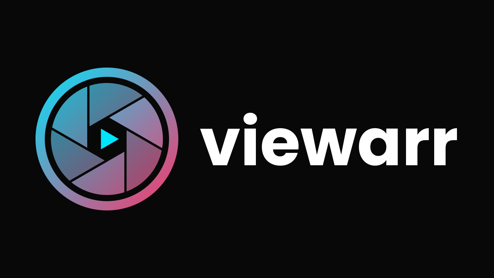
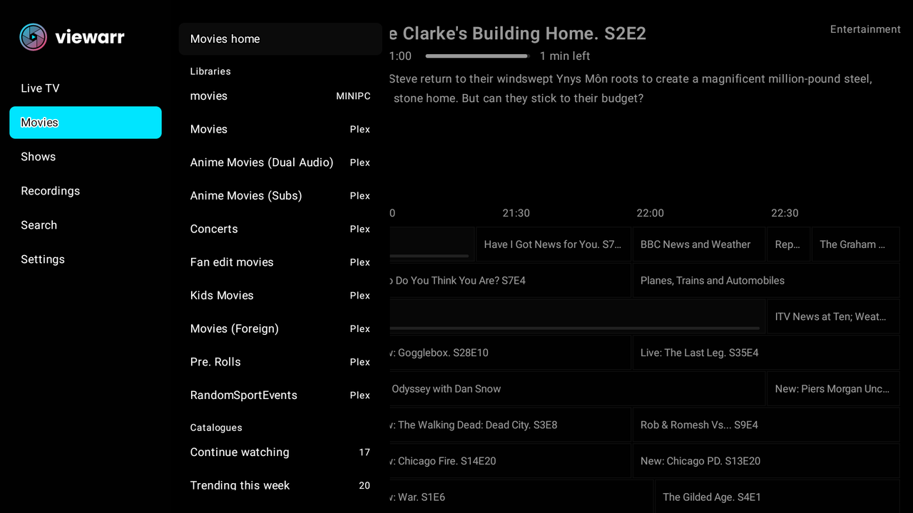
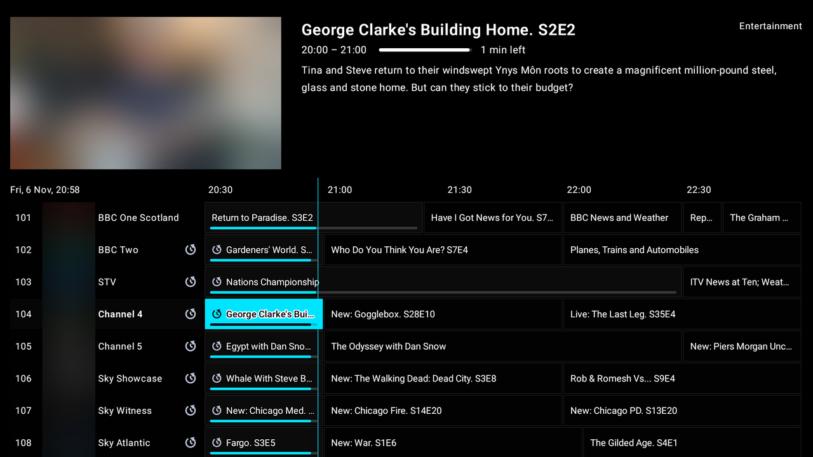
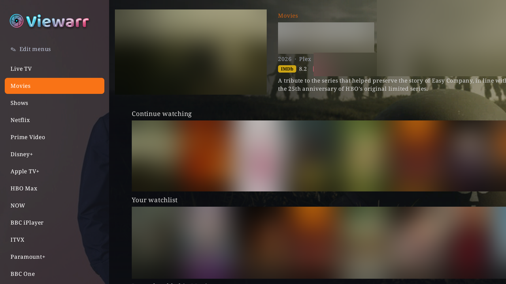
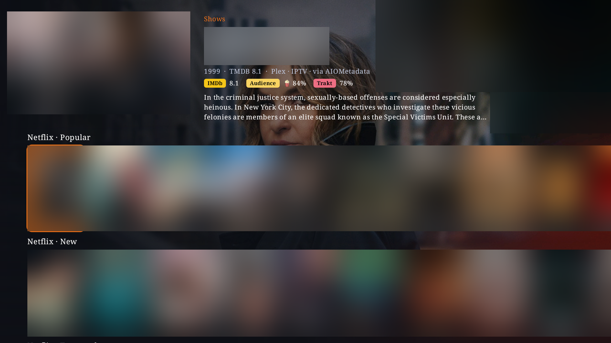
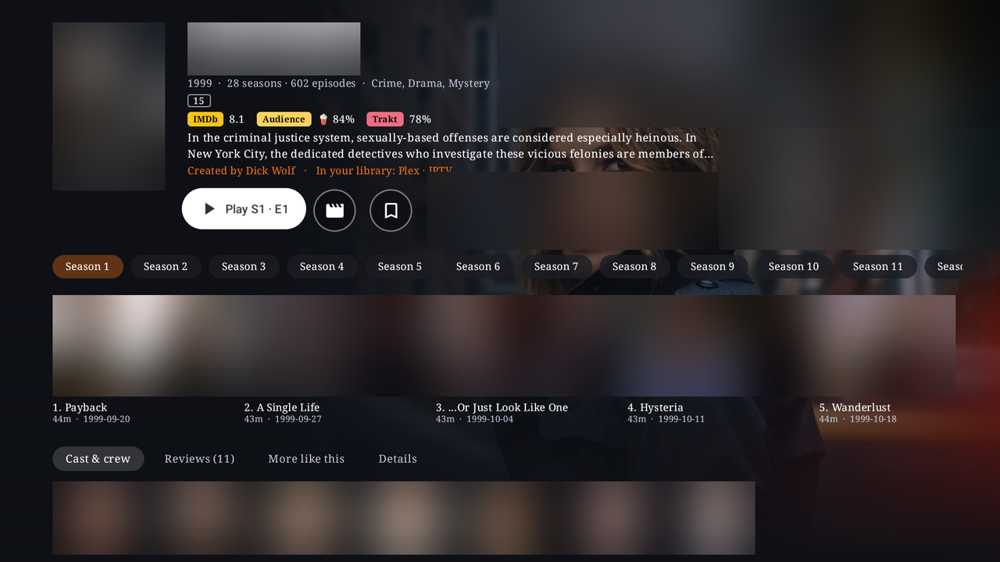
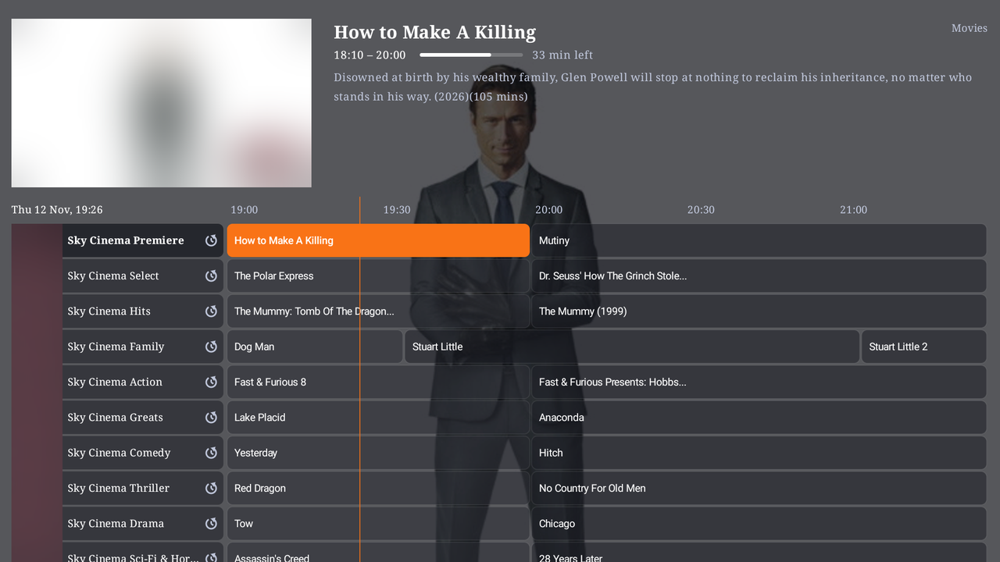

<p align="center">
  
</p>

<p align="center"><b>Live TV and streaming for Android TV, built around Dispatcharr.</b></p>

Viewarr is an Android TV app that brings your live TV and your films and shows together in one place. Live TV comes from your own [Dispatcharr](https://github.com/Dispatcharr/Dispatcharr) server; films and shows come from Plex, Jellyfin/Emby and addons you add, with TMDB and Trakt for discovery.

Viewarr doesn't provide any content. It plays only what your own servers and accounts give it.

<p align="center">
  
  
  
  
  
  
</p>
<p align="center"><sub>Artwork in the screenshots is blurred: posters, programme pictures and channel logos belong to their owners.</sub></p>

> **Status: early beta.** It's tested on an Amlogic Android TV box (2 GB). For the smoothest films and full surround sound, a stronger box such as an Nvidia Shield TV Pro helps. Things may break; please report anything odd in [Issues](../../issues).

## Previewarr (preview)

**Previewarr** is a preview of the next Viewarr interface, released alongside it from this repo. It's the same app underneath (live TV, the guide, films and shows, music, sports, the same setup and the same [Viewarr plugin](#viewarr-plugin-optional)), with a different way in:

- **A home screen** of tiles (Live TV, Movies, TV Shows, My Libraries, Music, Sports and your streaming services, which you can move or hide) and rows such as **Play next** and **Recently added**, in place of the side menu.
- **One simple Settings page** with the basics only.
- Live TV and films carry on in the corner of the home screen while you browse.

It installs alongside Viewarr (you don't need both), with an orange and pink icon so you can tell them apart. It's a preview, so it may change; **Viewarr carries on as the main app**.

Install it with Downloader: enter the code **9332422** (or `https://github.com/petebutty/previewarr/releases/latest/download/previewarr.apk`). See the **[Previewarr guide](docs/PREVIEWARR.md)**.

## Highlights

- **One glass menu on the left** that slides the page aside, and a **top-left window** where live TV, a film or a trailer keeps playing while you browse.
- **A classic IPTV-style TV guide** for your Dispatcharr channels, up to 7 days ahead, with catch-up, pause and rewind, **Start over**, **Go to show**, **★ favourites** and channel groups in your own order.
- **Recordings, reminders and one-press record** on your Dispatcharr server. The Recordings page sorts what you've recorded into shows, films and sport with posters from TMDB, remembers where you stopped, and puts recordings in Continue watching and on Trakt. **Multi-view** of up to four channels.
- **Sports**: follow teams and leagues, see which channel shows each game, and get score alerts for the teams you choose. **Live now** lists the games on right now.
- **No Dispatcharr?** Use an IPTV provider's Xtream Codes login or an M3U playlist, and save several sources.
- **Films and shows** from Plex, Jellyfin, Emby, your addons and your IPTV provider, in three **browsing styles** (Viewarr, Cinema with trailers in the poster, or Lite for weaker boxes), with Netflix-style rows, full libraries with sort, filter and A–Z, and your **streaming services** in the menu.
- **Just added**: for 15 UK streaming services (Netflix, BBC iPlayer, Disney+ and more), a row of what actually arrived on each lately, new seasons included.
- **Viewarr on your TV's home screen**: channel groups (what's on now, with live previews where the launcher allows) and any Movies or Shows row, kept fresh even while Viewarr is closed.
- **One Play button** that picks the best copy you have; hold OK on Play to choose the source yourself. **Auto-play match** rules (4K, Dolby Vision, Atmos, English…) decide which addon stream plays, with **Cached only** and **Try the next stream** if one fails.
- **Watch progress for IPTV films and shows** too: Resume, watched ticks and Continue watching, shared between your TVs through your Dispatcharr user (Dispatcharr and Xtream keep none themselves).
- **Skip intro, next episode** and a **mini player** that keeps a film going while you browse.
- **Music** from Navidrome, Plex, Jellyfin or Emby, with a home page made from what you play (Your Mix, daily mixes, Because you played…), endless radio, lyrics, the queue, artist pages and a spinning vinyl Now Playing.
- **An info bar you arrange yourself**, in **14 styles** from glass to a soft fade: show, hide and move its buttons, and add extras such as Favourite, Last channel, Audio sync, a Sleep timer and TV settings. Browse channels in it without changing until you press OK. Press Down for **rows you choose** under it: next episodes, Continue watching, favourite or recent channels, what's on now and more.
- **Frame rate matching** for films and live TV (the TV switches to 50 Hz for UK channels), with frame-rate badges on the info bar; for films and shows the TV switches as they open, with the frame rate from Plex, Jellyfin or Emby, so the sound works from the start.
- **Source switching without a break**: the channel keeps playing while its backup stream opens, then swaps in; stalled streams reconnect by themselves, and the info bar shows which provider you're on.
- **Report a problem** on any channel (wrong guide, times out, dead stream, logo, name) by holding OK: with the [Viewarr plugin](#viewarr-plugin-optional) the fix reaches the whole house, with Undo for admins.
- **Every remote button your way**, with Classic and Viewarr presets.
- **Your setup saved on Dispatcharr**, so a new TV picks it up, with earlier versions to go back to and every restore undoable. *(Profiles for everyone in the house, and sharing with friends in another house, are coming soon.)*
- **Settings codes**: share your look, playback and remote settings with another TV (a friend's, or a tester's) as a short code, without their sign-ins or sources. Undo puts theirs back.
- **Fits every TV**: every page is laid out the same on every box. **App scaling** shrinks the whole picture for a TV that cuts off the edges, and **Text size** changes just the words.
- **Simple settings**: each page opens on the main choices, with the rest under **Customise** and the rarely needed ones on an **Advanced** page. **Easy setup** from your phone with a QR code, and **Search settings** to find any option by name.
- **Voice search** from the remote's mic button, and a **Christmas wallpaper** with falling snow.
- **No pop-ups you didn't ask for**: score alerts, reminders, update cards and What's new are all off until you turn them on.

## Viewarr plugin (optional)

The [Viewarr plugin](https://github.com/petebutty/viewarr-plugin) runs on your Dispatcharr server. You don't need it: Viewarr works fully without it, and each TV does the work itself while Viewarr is running (Just added rows, Live now, score alerts and the Live scores ticker, event channels only with a listing, sport recordings, and syncing IPTV progress with Emby, Jellyfin or Plex).

With the plugin, your server does all of that once for the whole house, even with every TV off. It also adds a few things only a server can do: **Best stream first** with night-time measuring of your streams, **Report a problem** fixes that reach every TV, UK football channels weeks ahead, and named **plugin backups**. See [Live TV](docs/LIVE-TV.md#viewarr-plugin-optional).

## The remote in a nutshell

- **Back** while watching (live TV or a film): the **mini player**. The picture keeps playing in the window at the top left while you browse.
- **Back** on the mini player: **full screen** again.
- **Hold Back** on either: **close the player**.
- **Left** opens the menu from any page. In the TV guide, Left goes back a programme and on into catch-up; **Menu (≡)** opens the menu (with the Classic preset, Left on what's on now opens the channel groups and **hold Left** goes into catch-up).
- **Back** in the menu closes it.

Hints at the bottom of the screen remind you the first few times. Every button can be changed: see **[Remote control](docs/REMOTE.md)**.

## What you need

- An **Android TV** device (Android 8 or newer): Google TV, Nvidia Shield, Formuler, Chromecast with Google TV, Fire TV and so on.
- A phone on the **same Wi-Fi** as the TV, for the easiest setup (you can also use the remote).
- For live TV: a **Dispatcharr** server and an account on it (Standard or Admin user; source switching, stream info and plugins need Admin), or an IPTV provider's Xtream Codes login, or an M3U playlist.
- Optional:
  - A free [TMDB](https://www.themoviedb.org/) API key, needed for the Movies & Shows pages.
  - A Trakt account.
  - A Plex server.
  - An addon manifest link.
  - A Jellyfin or Emby server.
  - A Seerr (Overseerr / Jellyseerr) server, for requests.
  - A free MDBList API key, for extra ratings.
  - A Navidrome server, or music libraries on Plex, Jellyfin or Emby, for Music.
  - The [Viewarr plugin](#viewarr-plugin-optional) on your Dispatcharr server.

## Install

1. On your TV, install the **Downloader** app (by AFTVnews) from the Play Store / Amazon Appstore.
2. In Downloader, enter the code **7623981** (or this link; both always get the newest version):

   `https://github.com/petebutty/viewarr/releases/latest/download/viewarr.apk`

   Allow Downloader to install apps when asked. (Or download `viewarr.apk` from [Releases](../../releases) and copy it over with **Send Files to TV**, or use `adb install`.)
3. Open Viewarr and follow the setup. It takes a few minutes.
4. Optional: install the [Viewarr plugin](https://github.com/petebutty/viewarr-plugin) on your Dispatcharr server, so the server does the daily and sport work for every TV in the house. Viewarr works fully without it.

The full walkthrough, with what each step needs and troubleshooting tips, is in the **[setup guide](docs/SETUP.md)**.

## Guides

- **[Setup](docs/SETUP.md)**: installing, what to have ready, the first run and setting up on your phone
- **[Getting around](docs/GETTING-AROUND.md)**: the glass menu, editing it, search, the top-left window and the info bar
- **[Live TV](docs/LIVE-TV.md)**: the TV guide, catch-up, recordings, multi-view, sport, the Viewarr plugin, several sources and rows on your TV's home screen
- **[Films & shows](docs/FILMS-AND-SHOWS.md)**: rows, libraries, streaming services and Just added, title pages, players, search, Seerr and Trakt
- **[Music](docs/MUSIC.md)**: sources, the Music home and radio, Now Playing, the queue, artist pages and music settings
- **[Remote control](docs/REMOTE.md)**: what every button does, and changing them
- **[Settings](docs/SETTINGS.md)**: every Settings page, briefly
- **[Profiles and sharing](docs/PROFILES.md)**: coming soon (switched off for now); setup saved on Dispatcharr
- **[Troubleshooting](docs/TROUBLESHOOTING.md)**: channels, playback, a slow box, music
- **[Privacy](docs/PRIVACY.md)**: what's stored and what's sent where
- **[Controlling Viewarr from outside](docs/AUTOMATION.md)**: `viewarr://` links for ADB and home automation
- **[Home Assistant](docs/HOME-ASSISTANT.md)**: lights that follow what you watch, pop-ups on the TV, voice and phone control
- **[Previewarr (preview)](docs/PREVIEWARR.md)**: the home-screen version of Viewarr, its tiles, rows, mini player and simple settings

## Building from source

Requirements: JDK 17 and the Android SDK (platform 35).

```bash
git clone https://github.com/petebutty/viewarr.git
cd viewarr
./gradlew assembleRelease
```

Optional private files in the project root (they're git-ignored):

- `secrets.properties`: `traktClientId=…` from your own app at [trakt.tv/oauth/applications](https://trakt.tv/oauth/applications). Use `urn:ietf:wg:oauth:2.0:oob` as the redirect URI. Without this file, Trakt isn't offered. Optional: `reportNotify=<ntfy topic>` for Send a report's notices to you (left out, reports still work, no notice is sent).
- `keystore.properties`: `storeFile`, `storePassword`, `keyAlias` and `keyPassword` for your release signing key. Without it, builds are signed with the debug key.

## Privacy

Viewarr has no analytics, no ads and no servers of its own: it talks only to the services you connect. Details are in **[Privacy](docs/PRIVACY.md)**.

## Licence

Viewarr is free software under the **GNU General Public License v3.0**: see [LICENSE](LICENSE).

It's built on:
- [libmpv-android](https://github.com/jarnedemeulemeester/libmpv-android) (MIT), which bundles mpv and FFmpeg.
- Jetpack Compose for TV, AndroidX Media3 (ExoPlayer), Hilt, Room, Retrofit/OkHttp, kotlinx.serialization, Coil and ZXing (all Apache 2.0).
- [jellyfin-androidx-media](https://github.com/jellyfin/jellyfin-androidx-media) FFmpeg decoders (GPL-3.0).
- [NewPipe Extractor](https://github.com/TeamNewPipe/NewPipeExtractor) (GPL-3.0) with Mozilla Rhino (MPL-2.0) and jsoup (MIT), for YouTube trailers.
- Bouncy Castle (MIT-style).
- The Poppins font (SIL Open Font License).

Not affiliated with Dispatcharr, Plex, Trakt, TMDB, Stremio, Jellyfin, Emby or YouTube. This product uses the TMDB API but is not endorsed or certified by TMDB.
