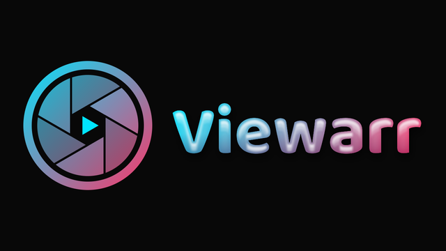
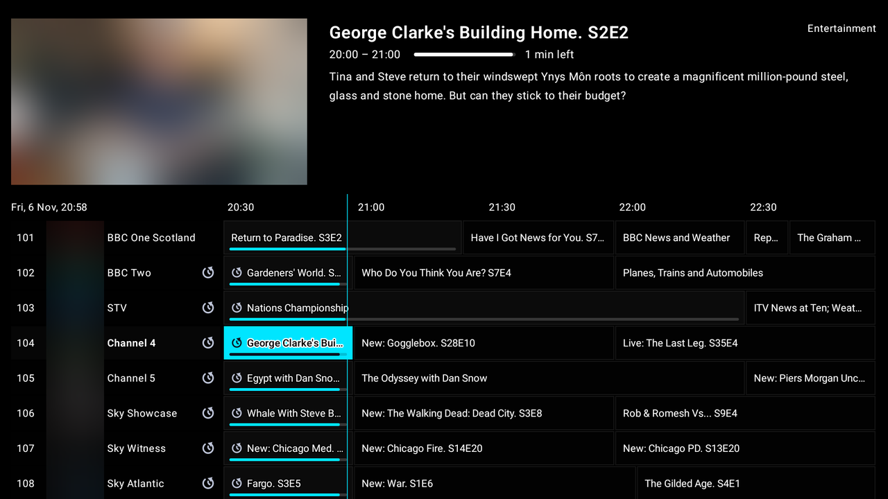
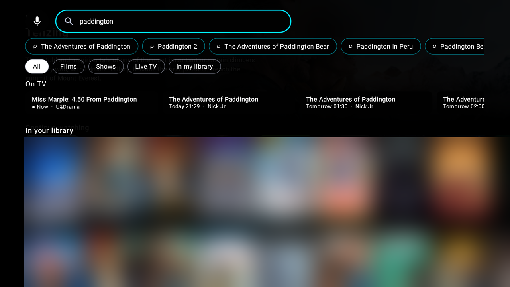
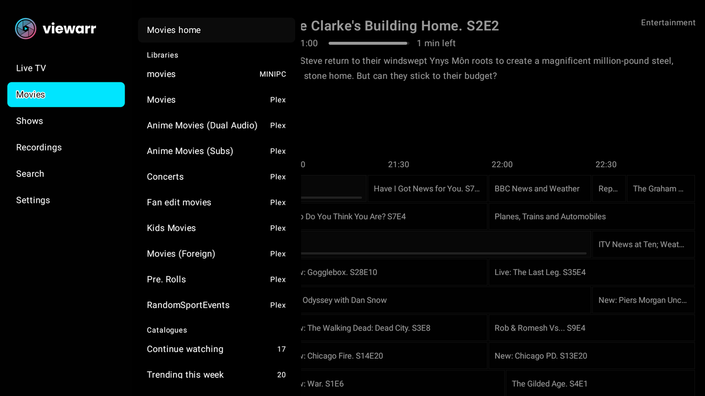
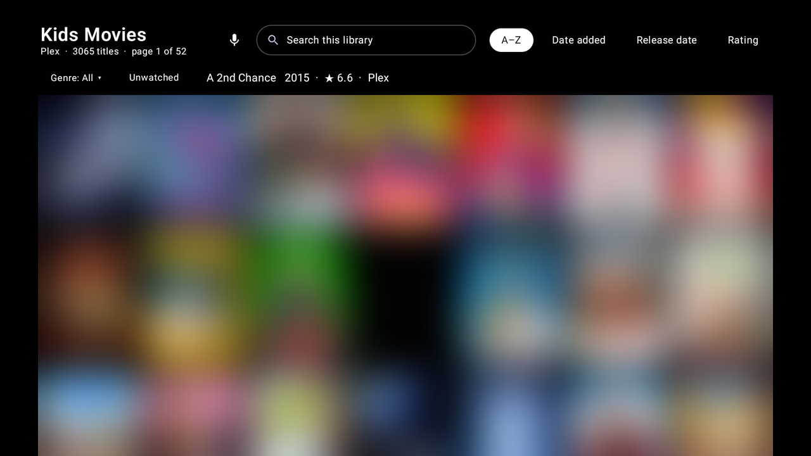

<p align="center">
  
</p>

<p align="center"><b>Live TV and streaming for Android TV, built around Dispatcharr.</b></p>

Viewarr is an Android TV app that brings your live TV and your films and shows together in one place. Live TV comes from your own [Dispatcharr](https://github.com/Dispatcharr/Dispatcharr) server; films and shows come from Plex, Jellyfin/Emby and addons you add, with TMDB and Trakt for discovery.

Viewarr doesn't provide any content. It plays only what your own servers and accounts give it.

<p align="center">
  
  
  
  
</p>
<p align="center"><sub>Artwork in the screenshots is blurred: posters, programme pictures and channel logos belong to their owners.</sub></p>

> **Status: early beta.** It's tested on an Amlogic Android TV box (2 GB). For the smoothest films and full surround sound, a stronger box such as an Nvidia Shield TV Pro helps. Things may break; please report anything odd in [Issues](../../issues).

## Features

**Live TV (Dispatcharr)**
- A TiviMate-style TV guide with channel logos, categories, programmes going back and forward in time, and a progress bar under what's on now (on every channel, only the one you're watching, or off).
- Catch-up: replay programmes from the past, where the channel supports it.
- **Back and the guide:** Back from full screen glides the channel into the guide's preview. Back in the guide jumps to what's on now, then asks to exit (or, with the Live TV hub, goes full screen again); **Back twice quickly** from live TV always exits. Holding Back opens the channel groups. The remote's **Stop** button stops the channel and leaves you on the guide. Live TV's controls (OK) include **Transparency** (adjust the see-through levels over the picture) and **Settings**.
- **Live TV hub (optional):** a different way to use Viewarr, chosen in **Settings → Navigation → Start → Style**. Viewarr opens on your last channel, Back from any page goes back to it, and on live TV **OK, then Down** shows a row of **shortcuts**: pages (Movies, Shows, the guide, Music, Recordings, Search, Settings), **networks** (Netflix, BBC One, HBO… each opening its own rows: Popular, New, Top rated), your Plex / Jellyfin / Emby libraries and rows, and your music. Down again previews the highlighted shortcut's rows. Opening one keeps the channel playing in a corner while you browse; Back takes it full screen again. Films have the same row (OK, then Down) and Back sends a film to the corner. Shortcuts can be round, rounded squares or wide logo tiles, in three sizes; hold OK on one to move it along the row, refresh just its rows, or hide it. **Refresh**, at the end of the row, fetches every row again from your addons and servers (new networks on AIOMetadata turn up without restarting Viewarr). **Choose network shortcuts** builds network rows from your own addons, or on your own **AIOMetadata** instance with your TMDB key (UK and US lists to pick from). Viewarr doesn't supply addons: you add your own.
- **One-press record:** the Record button schedules what's on (or the highlighted programme) straight away.
- **Pause and rewind live TV** on catch-up channels (using Dispatcharr's catch-up): pause, then carry on from that moment; rewind with Left, or press OK, Up to the progress bar and move a marker back to where you want to jump to; fast-forward back to live or press **Go live**. The seek bar shows where you're playing and how far through the programme live is.
- **Start over / Go to show:** missed the beginning of something in the guide? Hold OK on it and choose **Start over**: the channel's catch-up if it has it, otherwise Viewarr finds the film (or the show's episode) in your Plex, Jellyfin or Emby, or your addons, and plays it from the beginning. **Go to show** opens its page. **Search catch-up** lists every showing you can still replay.
- Reminders: get a pop-up when a programme starts; small cards when a recording starts, finishes or fails.
- The guide shows a picture of the highlighted programme: the guide's own artwork from Dispatcharr when it has some, otherwise one found on TMDB.
- **Source switching:** see every stream behind a channel (and which provider it's from) and switch Dispatcharr to another one from the remote. **Stream info** shows Dispatcharr's live view: source, provider, resolution, codecs, bitrate and viewers. *(Admin users.)*
- **Dispatcharr plugins** (Settings → Dispatcharr plugins): switch installed plugins on and off, press their action buttons, change simple settings, and install or update plugins from your server's plugin store. *(Admin users.)*
- Recordings on your Dispatcharr server: record one programme or a whole series (every episode, or new ones only). Then watch, stop or delete recordings from the app.
- **Multi-view:** watch up to four channels at once (OK while watching → **Multi-view**). Arrows move between windows and the sound follows the one you've selected; OK makes it full screen; hold OK to change or remove a window. Each window counts as a stream on your provider; Dispatcharr's failover to a backup provider works per window.
- A channel list over the picture (Up/Down while watching), channel groups, and number keys to type a channel number. Press Right on a channel to see its programmes, earlier and coming up; earlier ones play from catch-up.
- No Dispatcharr? Sign in with your **IPTV provider's (Xtream Codes) login** for channels, guide, catch-up and the provider's films and series, or add an **M3U playlist** link (with an optional XMLTV guide link). For logins and playlists, **Choose groups** leaves out groups you never watch, so their channels and guide aren't stored.
- **Several sources:** save more than one Live TV source (several Dispatcharr instances, IPTV logins or playlists), name them, and switch from the guide's menu or full screen (Up, Left, Left). The three most recent keep their guide on the box, so switching is instant.

**Films & shows**
- Netflix-style rows: Continue watching, your Trakt watchlist and recommendations, recently added on Plex, and trending, popular and top-rated titles from TMDB. **Upcoming episodes** shows when the next episodes of the shows you follow air (from Trakt, or your servers). Rows that repeat across servers (Continue watching, a library's Recently added) are combined into one. Choose which rows show, and their order, in **Settings → Home page & menu**.
- **Your whole library:** Movies and Shows in the menu list your Plex, Jellyfin and Emby libraries, plus **IPTV Movies / IPTV Shows** (your provider's films and series through Dispatcharr), with your rows tucked under **Jump to a row**. Going into a list slides the one before it away, like the guide's channel groups; **Right on a library** lists its categories (IPTV) or genres, or collections, decades, years, studios or age ratings, to jump straight into (Settings → Navigation → Menu). **Hold OK on a library** (or **Edit this list**) to switch libraries on or off and move them, right there in the menu. A library is one continuous grid with **Sort** and **Filter** built from what your own server offers (Plex lists its own sorts and filters per library, such as genre, decade, network, studio, resolution, HDR / Dolby Vision, Atmos, unwatched and in progress; Jellyfin and Emby have theirs), removable filter chips, an **A–Z strip** to jump to a letter, and search with voice. Each library remembers its sort and filters. Hide, reorder or rename libraries in **Settings → Home page & menu**.
- **Several Plex servers:** every server on your Plex account is used, in rows, search and "In your library". Switch any of them off in Accounts & sources → Plex.
- **Title pages on one screen:** the title's logo, details and description, ratings from TMDB, IMDb, Rotten Tomatoes (critics and audience), Metacritic, Letterboxd and Trakt, and tabs for cast & crew (with photos; OK opens their films and shows), reviews from TMDB and Trakt users, more like this and details. IMDb and Rotten Tomatoes come from your Plex when it has them; add a free **MDBList** key in Accounts & sources for every title.
- **Title logos** on the Movies/Shows header, the title page and the player, and a loading screen with the title's backdrop and a gently "breathing" logo while a film or episode starts.
- **Shows:** the seasons and that season's episodes sit on the show's page, opening on the season you're up to (watched ticks and progress bars included). OK plays an episode; hold OK to pick its source.
- **Badges on title pages:** age rating (UK or US, your choice), picture (4K, HDR, Dolby Vision), sound (Dolby Atmos, DTS:X, 5.1…), CC, and when a film would end if you started it now.
- **Films:** pick the **Audio & subtitles** before Play (films on your Plex, Jellyfin or Emby), and **Mark watched / unwatched** on your servers and Trakt.
- **From the start:** part-way through a film or episode? A button beside Resume plays it from the beginning.
- **One Play button:** it plays the best copy you have: your servers at home first (Plex, Jellyfin, Emby), then your servers away, then your **addons** (e.g. AIOStreams), then IPTV. A copy whose file has gone is skipped. **Hold OK on Play** to pick the source yourself. Shows get **Play / Resume S·E**, carrying on from Plex, Jellyfin/Emby or Trakt.
- **Addons with their own titles** (no IMDb or TMDB id, such as fan edits) get proper title pages with their seasons and episodes, and addon TV, sports and event catalogues play straight away.
- **Actor pages** with their photo, dates and biography, then their films and shows. Films in a series get a **Collection** tab (e.g. the Dune films).
- Watch progress is sent back to Plex, Jellyfin/Emby and Trakt, and your **Trakt watched history** comes back: episodes and films you've watched anywhere get their tick, and Play / Resume carries on from the furthest place any of them knows. **Sync with Trakt now** is in Accounts & sources → Trakt, with an optional **Copy watched to Plex**.
- **Player controls:** OK brings up the seek bar (with preview pictures) and icon buttons: Play / Pause and Stop, then Details, Audio, Subtitles, Media info and switching player; the remote's Play/Pause button pauses. The remote's **Info** button (or Details) shows the poster, episode and synopsis, which also appear by themselves a moment after you pause.
- Two players: the **built-in player** (the default: light, with surround sound passed to your TV or receiver) and **mpv** (plays almost any file, codec or soundtrack). If the built-in player can't play a file, Viewarr switches to mpv by itself at the same moment. Swap between them mid-film from the hold-OK menu too, keeping your soundtrack and subtitles; or choose mpv for everything in Settings → Playback.
- **Seek bar with preview pictures:** press Down while watching, scrub with Left/Right, OK to jump. Previews come from Plex / Emby / Jellyfin when the server made them, otherwise the box takes them from the film itself.
- **Smooth playback on weak boxes:** mpv draws straight to the screen, the TV can switch to the film's frame rate, and surround passthrough only uses formats your TV or receiver really accepts.
- **Playback settings:** audio and subtitle language, surround passthrough to a receiver, stereo downmix, night mode, subtitle size, resume, and Plex quality.
- **Search** puts what you meant first (a person, a channel, or your own copy of a film) and pops up over any screen (hold Menu, or pick a button in Settings → Remote buttons): your Plex, Jellyfin and Emby titles in one row, people with their films and shows, TV channels and what's on the guide (watch it, record it or get a reminder), quick picks as you type, filters and voice search (Viewarr asks for the microphone the first time; works on the Nvidia Shield too). The menu's Search panel keeps your recent searches. A **Catch-up** row (and pill) finds programmes from the last few days you can replay, using Dispatcharr's own guide search; moving onto a pill brings that kind of result to the top, OK on it filters.
- **Watch Next:** your Continue watching appears in the Android TV home screen's Watch Next row.
- **Make it yours:** Settings → Appearance sets the text size, an on-screen clock, channel logos and programme pictures in the guide, the labels on posters, and what title pages show (each rating, the logo, trailer, episodes row and each tab; anything off isn't fetched). Settings → Playback sets how long the controls stay up and how big they are, seek-bar previews, the next-episode countdown, **Still watching?** for Live TV (stops a TV left on, freeing a provider connection) and a **low-memory mode** for 1–2 GB boxes (it turns off, and hides the settings for, wallpapers and title-page artwork, trailer previews, multi-view, programme pictures, title logos and the extra ratings).
- **Settings → About:** the version, this TV (model, memory, storage, screen), what Viewarr stores on it (each source's TV guide, artwork, updates) with buttons to clear artwork and old updates, and your Live TV sources.
- **Music (optional):** turn it on in Accounts & sources → Music. Your music from **Navidrome** (or another Subsonic server) and the music libraries on your **Plex, Jellyfin or Emby**, joined into one library (an album on two servers shows once), with each source switchable on or off. A short Music home, Albums A–Z, Artists, Playlists, Genres, Favourites and Recently added from the menu, each with search and voice search, music in search, **Now Playing with a visualiser**, and a now-playing bar that keeps the music going while you browse (hold Back to bring Now Playing back). Plays count on the server they came from (Navidrome scrobbles, so ListenBrainz/Last.fm too). Navidrome is found on your network automatically, and Music can be set up from your phone.
- **From the TV guide:** hold OK on a programme for **Start over** (the channel's catch-up if it has it, else your own servers or addons), **Go to show** (its episodes, at the one you're up to), recording, reminders and Seerr requests.
- **Seerr requests:** hold OK on a poster to request a film or show you don't have yet (addon titles, and titles you only have on your IPTV provider, too). From the TV guide, hold OK on a programme and choose **Request on Seerr…**: a film, or a show's missing episodes (seasons already on your servers aren't asked for again).
- **Watchlist of your choice** (Settings → Watchlist): Add / Remove on title pages, the hold-OK menu and the "Your watchlist" row use **Trakt**, your **Plex** watchlist, or **Jellyfin / Emby favourites**.

**Easy setup**
- **Profiles:** everyone on the TV gets their own profile (a Dispatcharr user): their own settings, sign-ins and library views, an optional PIN, and **Who's watching?** when Viewarr opens if you want it. Dispatcharr admins get **Settings → Users & profiles** to create and delete users, reset passwords, set live TV limits (streams at once, channel groups), choose which services each person gets (including their own Navidrome user) and **what they can do**: Seerr requests, recording, catch-up, IPTV films, accounts, Live TV sources and settings can each be allowed or locked. Your Trakt and Plex sign-ins are never handed out.
- **First run:** a new install asks whether you're setting up your own server or were invited, then shows a five-page tour of how Viewarr works (again any time from Settings → About).
- **Friends in another house:** set each server's outside address once (**Users & profiles → Away addresses**); Viewarr uses the home address when it can and switches to the outside one by itself when it can't. **Sign-in details for another house** gives you the outside address and that person's API key to text or email; on their TV they choose **I was invited**, type the address and paste the key, and the setup you prepared for them arrives. Your Dispatcharr login page never needs to be open to the internet.
- **Your setup, saved on Dispatcharr:** Viewarr keeps a copy of its setup (your services, home rows, appearance, playback and remote settings) on your Dispatcharr server, for your user. Sign in to the same Dispatcharr user on another TV, or after a reinstall, and Viewarr offers to restore it all. Sign-ins are encrypted on the TV before they're saved; settings that depend on the box (surround sound, frame rate, decoding) stay on each TV. Turn it off, or leave sign-ins out, in **Settings**. *(Needs Dispatcharr 0.33 or newer.)*
- Scan a QR code on the TV and set everything up on your phone. Passwords and keys are encrypted between your phone and the TV.
- Setup finds **Dispatcharr, Jellyfin, Emby and Seerr** on your home network by itself, Jellyfin signs in with **Quick Connect** (no password), and you can tick **several Plex servers**. QR codes take you straight to Dispatcharr's Users page (for your API key) or to the phone page to type your login.
- **Presets** (Settings → Remote buttons → Presets): **TiviMate-style** (Up / Down change channel, Left the channel list, Right the previous channel; in the guide Left goes back to now then the groups, hold Left for catch-up, Back shows the groups and then asks to exit) or **Viewarr**, set in one go. The buttons a preset sets are listed under it to change; it then shows **Custom (from …)**. Every preset keeps a way to the menu and a way out.
- **Settings that say where things are:** a line at the top of Settings describes the highlighted entry, and every section says what it covers. **Remote buttons** is what each button does; **Navigation** is Classic menus or the Live TV hub (and its shortcuts), where the app opens, the side menu and poster rows.
- **Your buttons, your way** (Settings → Remote buttons): for the guide, live TV, films and menus, a picture of the remote shows what the main buttons do, and you choose what Hold Back, Record, the colour buttons and Info do (IPTV-style colour defaults: record, channel groups, a day back / forward…). Reset per screen, or all buttons at once. **Button hints** at the bottom of the screen say what the buttons do where you are (first few times, always or off).
- **Extra buttons** (Settings → Remote buttons → Search & extra buttons): give play/pause, skipping, stop, info, audio & subtitles, channel up/down, the TV guide or record an extra button, such as a colour button or one your remote has spare. Remotes with **Guide** and **Record** buttons open the TV guide and record what's on.
- 17 colour themes (an **OLED black** one by default), square or rounded guide corners, day-first or month-first dates and 24- or 12-hour times, and remote-control options.
- **Wallpapers:** a built-in design, or the artwork of the programme you've highlighted, behind the guide, menus and settings. **Settings → Appearance → Transparency** has sliders for the channel list over live TV, the guide, and the wallpaper's dimming. Movies and Shows always show the highlighted title's artwork across the page.
- Only want live TV? Turn Movies & Shows off in **Settings → Appearance → Menu**.

## What you need

- An **Android TV** device (Android 8 or newer): Google TV, Nvidia Shield, Formuler, Chromecast with Google TV, Fire TV and so on.
- A phone on the **same Wi-Fi** as the TV, for setup.
- For live TV: a **Dispatcharr** server and an account on it (Standard or Admin user; source switching, stream info and plugins need Admin), or an IPTV provider's Xtream Codes login.
- Optional:
  - A free [TMDB](https://www.themoviedb.org/) API key, needed for the Movies & Shows pages.
  - A Trakt account.
  - A Plex server.
  - An addon manifest link.
  - A Jellyfin or Emby server.
  - A Seerr (Overseerr / Jellyseerr) server, for requests.

## Install

1. On your TV, install the **Downloader** app (by AFTVnews) from the Play Store / Amazon Appstore.
2. In Downloader, enter the code **7623981** (or this link; both always get the newest version):

   `https://github.com/petebutty/viewarr/releases/latest/download/viewarr.apk`

   Allow Downloader to install apps when asked. (Or download `viewarr.apk` from [Releases](../../releases) and copy it over with **Send Files to TV**, or use `adb install`.)
3. Open Viewarr and follow the setup. It takes a few minutes.

The full walkthrough, with what each step needs and troubleshooting tips, is in the **[setup guide](docs/SETUP.md)**.

## Remote control

| Where | Button | What it does |
|---|---|---|
| TV guide | OK | Watch live, or replay a past programme. On a programme still to come: show its details. |
| TV guide | Hold OK | Record options (this programme, or the series) |
| TV guide | Left (tap / hold) | Earlier programmes and catch-up / scroll fast (TiviMate-style: back to now, then the groups / hold for catch-up) |
| TV guide | Hold Back | The menu, on the channel groups (Left again: the main menu) |
| TV guide | Back | Jumps to now, then asks to exit (press Back again). Live TV hub: back to the channel full screen. TiviMate-style: the channel groups |
| TV guide | Stop | Stop the channel in the preview |
| TV guide | Number keys | Type a channel number |
| Watching live TV | Back | The guide, the channel gliding into its preview (twice quickly: exit) |
| Watching live TV | Up / Down | Channel list (Left from there: channel groups); TiviMate-style: change channel |
| Watching live TV | Left / Right | Rewind ("Rewind?" first) / skip ahead; TiviMate-style: channel list / previous channel |
| Watching live TV | Stop | Stop, back to the guide |
| Watching live TV | Channel + / − | Change channel |
| Watching live TV | OK | Player controls (audio, subtitles, aspect, source, stream info, record) |
| Watching live TV (Live TV hub) | OK, then Down | Your shortcuts; Down again for their rows |
| Films & shows | Left at the start of a row, or Back | Menu |
| Film player | OK / hold OK | Pause / audio, subtitles and switch player |
| Film player | Down, then Left / Right, OK | Seek bar with previews: move, then jump there |
| Film player | Back | Close what's open (controls, details), then stop (your place is saved) |
| Film player | Stop (or the Stop button) | Stop (your place is saved) |
| Anywhere, nothing playing | Hold Back | The menu |

Most of these can be changed in **Settings → Remote buttons** (what each button does) and **Settings → Navigation** (Classic menus or the Live TV hub, the side menu, poster rows).

## Building from source

Requirements: JDK 17 and the Android SDK (platform 35).

```bash
git clone https://github.com/petebutty/viewarr.git
cd viewarr
./gradlew assembleRelease
```

Optional private files in the project root (they're git-ignored):

- `secrets.properties`: `traktClientId=…` from your own app at [trakt.tv/oauth/applications](https://trakt.tv/oauth/applications). Use `urn:ietf:wg:oauth:2.0:oob` as the redirect URI. Without this file, Trakt isn't offered.
- `keystore.properties`: `storeFile`, `storePassword`, `keyAlias` and `keyPassword` for your release signing key. Without it, builds are signed with the debug key.

## Privacy

- Viewarr has no analytics, no ads and no servers of its own. It talks only to the services you connect.
- Account details are stored on the TV, encrypted with the Android Keystore, and are left out of Android backups.
- The microphone is only used while voice search is listening (after you press the mic), and only if you allow it.
- The phone setup page runs on the TV only while the setup screen is open. It uses a one-time link, and everything you type is encrypted on your phone before it's sent.

## Licence

Viewarr is free software under the **GNU General Public License v3.0**: see [LICENSE](LICENSE).

It's built on:
- [libmpv-android](https://github.com/jarnedemeulemeester/libmpv-android) (MIT), which bundles mpv and FFmpeg.
- Jetpack Compose for TV, AndroidX Media3 (ExoPlayer), Hilt, Room, Retrofit/OkHttp, kotlinx.serialization, Coil and ZXing (all Apache 2.0).
- [jellyfin-androidx-media](https://github.com/jellyfin/jellyfin-androidx-media) FFmpeg decoders (GPL-3.0).
- [NewPipe Extractor](https://github.com/TeamNewPipe/NewPipeExtractor) (GPL-3.0) with Mozilla Rhino (MPL-2.0) and jsoup (MIT), for YouTube trailers.
- Bouncy Castle (MIT-style).
- The Poppins font (SIL Open Font License).

Not affiliated with Dispatcharr, Plex, Trakt, TMDB, Stremio, Jellyfin, Emby or YouTube. This product uses the TMDB API but is not endorsed or certified by TMDB.
