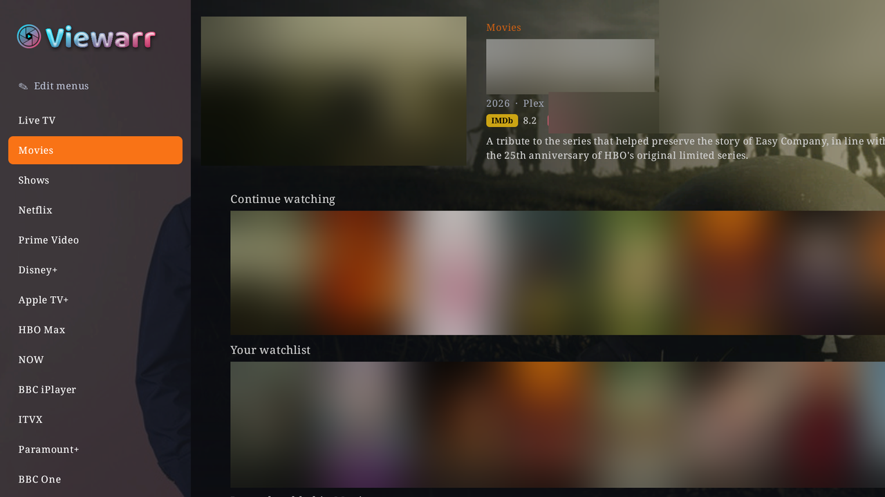
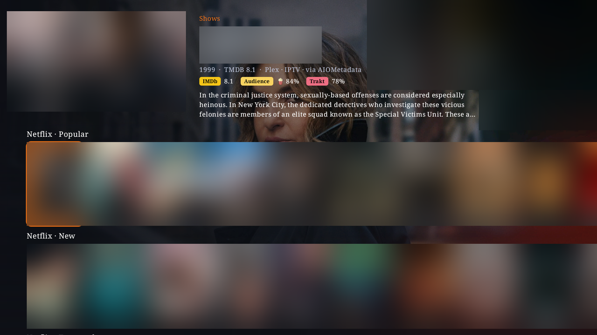
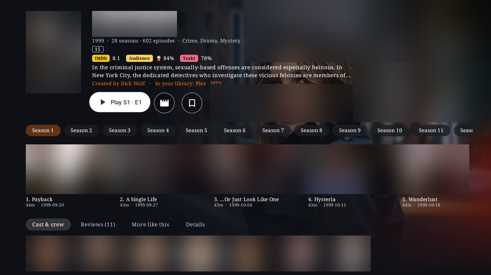

# Films & shows

Films and shows come from your Plex, Jellyfin and Emby servers, from addons you add (such as AIOStreams or AIOMetadata), and from your IPTV provider. TMDB and Trakt are used for discovery. Viewarr doesn't supply any addons or content: you add your own.

## The Movies and Shows pages



Netflix-style rows, with the highlighted title's details at the top and its artwork across the page. Rows include:

- **Continue watching**: a film or episode you stop partway moves to the front straight away. On Shows it also has your recordings (see [Live TV](LIVE-TV.md#watching-recordings)).
- Your **Trakt watchlist** and recommendations
- **Recently added** on your servers
- Trending, popular and top-rated titles from TMDB
- **Upcoming episodes**: when the next episodes of the shows you follow air (from Trakt, or your servers)

Rows that repeat across servers (Continue watching, a library's Recently added) are combined into one. Turn that off with **Combine rows from different servers** in **Settings → Home page & menu**.

If nothing is playing, the highlighted title's trailer plays in the window at the top left (**Settings → Playback → Trailers**). Press the remote's **Play/Pause** while it plays to watch that trailer full screen.

- **OK** opens a title. **Hold OK** gives a quick menu (watchlist, Seerr request and more).
- **Drop show**: hold OK on a show in Continue watching to drop it, here and on Trakt. Watching it again brings it back.
- **Mark watched** on a film takes it out of Continue watching straight away.

### Browsing styles

**Settings → Appearance → Browsing style** sets the look of Movies, Shows and the streaming services' pages in one go. *(0.29.0 and later.)*

| Style | What it looks like |
|---|---|
| **Viewarr** (the standard) | A top panel with the title's details on the left and its trailer in the window at the top right, and two rows to a page. With a live channel playing in the top-left window, the details move to the right. |
| **Cinema** | A bigger top panel, larger posters in one row along the bottom, and trailers that play in the poster. Up and Down turn a whole page at a time. |
| **Lite** | For weaker boxes: no top panel, no trailer previews or title logos, and smaller posters. The quickest to scroll. |

Each part can still be changed on its own (the style then says **Custom**):

- **Top panel**: Normal, Big or Off (more rows on screen), and **Row posters**: Normal, Large or Small. Both are in **Settings → Advanced → Screen & sizes**, as the pages are laid out around their normal sizes.
- **Other posters faded** (in **Appearance → Posters**): a slider (Off to 100%) for how much the posters you're not on fade, so the highlighted one stands out. Off keeps them all solid.
- **Highlight zoom** (in **Appearance → Posters**): the highlighted poster grows a little (Slight), more, or stays its size.

### Trailers in the poster

With **Settings → Playback → Trailers → Trailer previews play** set to **In the poster** (Cinema does this for you):

1. Rest on a poster and, after a moment (**Start after**), it widens and its trailer plays inside it (with sound when **Preview sound** is on).
2. After a while (**Then the big panel**: 1 to 5 seconds, or Never) the trailer grows into a big panel in the middle. **OK** on the playing poster does this at once.
3. In the big panel, **OK** opens the title's page. **Back** or an arrow closes the panel.

### Choosing your rows

**Settings → Home page & menu** has one list for **Movies** and one for **Shows**:

1. First, your libraries as the menu lists them: on or off, their order, and their names (hold OK on a library to rename it).
2. Then the rows on the page, top to bottom. Each row says where it comes from (Plex, Jellyfin, AIOMetadata…). These are the same rows the menu's **Jump to a row** lists.

OK turns an entry on or off. Right picks one up so Up / Down move it; OK puts it down.

You can also do this from the menu itself by holding OK on a menu entry (see [Getting around](GETTING-AROUND.md#editing-the-menu)).

### Continue watching from

Under the libraries in **Settings → Home page & menu**, **Continue watching from** has one switch for each of your servers, plus IPTV and Trakt. Switch one off and the films and episodes you're part way through there leave Continue watching everywhere: Movies, Shows, My Library and the row under the info bar. *(0.29.0 and later.)*

## Your libraries

**Movies** and **Shows** in the menu list your Plex, Jellyfin and Emby libraries, plus **IPTV Movies** and **IPTV Shows** (your provider's films and series through Dispatcharr). IPTV titles get pages found on TMDB by name when the provider gives no id. Your rows are tucked under **Jump to a row**.

- Going into a list slides the one before it away, like the guide's channel groups.
- **My Library** in the main menu lists every library on all your servers (films and shows together, under each server's name: your Plex servers, Jellyfin / Emby, IPTV), then your music. Moving onto one shows it behind; OK or Right goes into it, with Sort, Filter (genres, years…) and A–Z. Movies and Shows themselves are the discovery pages: their home rows, catalogues and Jump to a row. Which libraries show, and their order, are set in Settings → Home page & menu (or by holding OK on a menu entry). *(0.28.1 and later.)*

A library is one continuous grid. It moves a row the moment you press, then glides into place. It has:

- **Sort** and **Filter**, built from what your own server offers. Plex lists its own per library, such as genre, decade, network, studio, resolution, HDR / Dolby Vision, Atmos, unwatched and in progress. Jellyfin and Emby have theirs.
- Removable filter chips.
- An **A–Z strip** to jump to a letter.
- Search, with voice.

Each library remembers its sort and filters.

**Several Plex servers**: every server on your Plex account is used, in rows, search and "In your library". Switch any of them off in **Settings → Accounts & sources → Plex**.

## Streaming services



Streaming services and networks (Netflix, BBC One, HBO…) come from your own addons' rows, such as your own **AIOMetadata** instance. Each appears in the menu with its own page.

A service's rows are always in the same order: **Just added** (films and shows), then **New shows**, **New films**, **Originals**, **Popular**, **Top rated**. You can show or hide each row while editing the menu (hold OK on an entry), but not reorder them.

### Just added

**Netflix · Just added**, and the same for 15 UK services: Netflix, Prime Video, Disney+, Apple TV+, HBO Max, NOW, BBC iPlayer, ITVX, Paramount+, Sky Go, UKTV Play, My5, Discovery+, Crunchyroll and Shudder. Each row shows what actually arrived on that service lately, from JustWatch, older films newly added and new seasons included. A card says **Season 3 new** or the day it was added. *(0.29.3 and later.)*

- With the [Viewarr plugin](LIVE-TV.md#viewarr-plugin-optional) 0.6.2 or newer, your Dispatcharr server fetches the lists once a day for the whole house.
- Without it, each TV fetches them itself, once a day. *(0.29.5 and later.)*
- **Settings → Home page & menu → Use Just added instead of New** puts each service's Just added row in place of its New row on Movies and Shows.
- Just added rows can go on your TV's home screen too: **Settings → Live TV → Customise → Home screen rows → Add every Just added row** (see [Live TV](LIVE-TV.md#viewarrs-rows-on-your-tvs-home-screen)).

## Title pages



A title's page fits on one screen. The header stays put while the seasons, episodes and tabs scroll under it.

- The title's logo, details and description.
- **Ratings** from TMDB, IMDb, Rotten Tomatoes (critics and audience), Metacritic, Letterboxd and Trakt. Each can be on or off, in the order you choose (**Settings → Appearance → Ratings**). IMDb and Rotten Tomatoes come from your Plex when it has them; add a free **MDBList** key in **Settings → Accounts & sources** to get them for every title.
- **Badges**: age rating (UK or US, your choice in **Settings → Appearance → Title pages → Age ratings**), picture (4K, HDR, Dolby Vision), sound (Dolby Atmos, DTS:X, 5.1…), CC, and when a film would end if you started it now.
- **Tabs**: cast & crew (with photos; OK opens their films and shows), reviews from TMDB and Trakt users, more like this, and details.
- Films in a series get a **Collection** tab (for example, the Dune films).
- **Actor pages** show their photo, dates and biography, then their films and shows.

**Settings → Appearance → Title pages** turns each part on or off (each rating, the logo, trailer, episodes row and each tab). Anything off isn't fetched, so pages open faster.

Title logos also show on the Movies and Shows header and in the player. While a film or episode starts, a loading screen shows its backdrop and a gently "breathing" logo.

### One Play button

**Play** plays the best copy you have, in this order:

1. Your servers (Plex, Jellyfin, Emby): at home first, then away from home
2. IPTV (your provider's films and series)
3. Your **addons** (for example AIOStreams)

**Settings → Playback → Streams → Play order** changes the order (for example addons first). A source that has nothing, or whose file has gone, is skipped.

**Hold OK on Play** (or on an episode) to pick the source yourself: your copies, IPTV, and your addons' streams, which are searched as soon as the list opens.

#### Which addon stream plays

With **Addon streams** set to play the best one automatically, Viewarr picks from your addons' streams: within your quality limit first, instant (⚡) ones first, then the highest resolution. To change that:

- **Settings → Playback → Auto-play match**: rules for one thing each (4K, 1080p, 720p, REMUX, Dolby Vision, HDR, HEVC / x265, Atmos, TrueHD, DTS-HD, 5.1, English, Not CAM / TS…). Switch on the ones you want (each jumps to the top as you do) and sort them by importance (Right picks one up, Up / Down move it). The top rule decides first; among the streams it matches, the next one decides, and so on. **Add your own…** takes a word or a regex. It only picks; the lists stay as they are.
- **Streams → Cached only**: leave out Usenet and torrent streams that aren't instant, in the lists too.
- **Streams → Try the next stream** (on as standard): if the stream fails or hasn't started after 20 seconds, the next one plays (up to 3 more). Built-in player only.

Shows get **Play / Resume S·E**, carrying on from the furthest point you've reached anywhere (see [What you've watched](#what-youve-watched)).

Also on title pages:

- **From the start**: part-way through? A button beside Resume plays it from the beginning.
- **Audio & subtitles**: pick them before Play (films on your Plex, Jellyfin or Emby).
- **Mark watched / unwatched**, saved everywhere the title is: Trakt, each server it's on, and Viewarr's own record for IPTV (the message says where). A film marked watched leaves Continue watching straight away.

How addon streams are picked is set with **Settings → Playback → Addon streams**: choose from the list yourself, or let Viewarr start the best cached stream within your quality limit (**Best quality allowed**, in **Settings → Advanced → Streams**).

### Seasons and episodes

The seasons and that season's episodes sit on the show's page. It opens on the season you're up to, with watched ticks and progress bars (from Trakt, your servers and IPTV together). **OK** plays an episode; **hold OK** to pick its source.

Addons with their own titles (no IMDb or TMDB id, such as fan edits) get proper title pages with their seasons and episodes. Addon TV, sports and event catalogues play straight away.

## Watching

### Player controls

- **OK** brings up the seek bar (with preview pictures) and icon buttons: Play / Pause and Stop, then Details, Audio, Subtitles, Media info, switching player, Search, Transparency and Settings.
- **Hold OK on a button** to arrange them: OK shows or hides one, hold OK picks it up and **Left / Right** move it, **Back** finishes. Play / Pause always stays. It's one arrangement with live TV's controls, so changing either changes both. *(0.28.0 and later.)*
- The remote's **Play/Pause** button pauses.
- The remote's **Info** button (or **Details**) shows the poster, episode and synopsis. These also appear by themselves a moment after you pause.
- The seek bar shows how much is **loaded ahead** (lighter grey in front of what's played): a slow stream shows the grey only just ahead.
- **Down**, then **Left / Right** and **OK**: move along the seek bar with preview pictures and jump there. Previews come from Plex, Emby or Jellyfin when the server made them; otherwise the box makes them from the film itself (**Settings → Playback → Seek-bar previews**).
- **OK**, then **Left** on the first button opens the menu over the film.

**Settings → Playback → Customise → Player** sets how long the controls stay up (**Controls stay up for**); how big they are (**Player controls size**) is in **Settings → Advanced → Screen & sizes**.

### Next episodes and the rows under the bar

Watching a show, press **Down** from the buttons to see the next episodes in the info bar, with their release dates. Episodes not out yet are darker and say **Not out yet**. **OK** plays one.

More rows can go under it, in your order: Continue watching (everything together, or just IPTV, Trakt, or Plex / Jellyfin), Recent and Favourite channels, Recordings, Recently added, Your watchlist and **More like this**. Choose them in **Settings → Appearance → Info bar & controls → Rows under the info bar**. One row shows at a time (**2 of 4** beside its name); **Down / Up** move between them. The title playing isn't listed in its own Continue watching.

**Previous episode** and **Next episode** buttons can be added to the bar (hold OK on a button → OK on them, marked *not added*). They show while an episode plays, and say which episode they'll play.

### What you've watched

It all just works, whatever mix you use *(0.29.1 and later)*. There's nothing to choose:

- **Playing**: the server a film or episode plays from (Plex, Jellyfin or Emby) is told where you are, your pauses and skips, and marks it watched past 80%, as its own apps would. With Trakt connected, Trakt is told about every play too, wherever it plays from (servers, IPTV or addons). If Plex also sends your plays to Trakt, Trakt counts it as the same watch.
- **Playing from IPTV or an addon**: the same title on your servers is told too, so Plex, Jellyfin or Emby show it as watched or part-way, and where you stopped is kept on this TV and shared with your other TVs through Dispatcharr.
- **Mark as watched / not watched** goes everywhere the title is: Trakt, every server copy, and Viewarr's own record for IPTV.
- **Ticks**: watched if Trakt, a server or Viewarr's record says so.
- **Progress bars and resume**: the newest place you stopped, from your servers, Viewarr's record or Trakt (so a film paused in another Trakt app carries on from there on IPTV or an addon).
- **Continue watching**: Trakt's, each server's and IPTV's rows together, each title once, and anything finished anywhere taken out. Each one's **Continue watching from** switch still works.
- **Up next**: the furthest point you've reached in any of them.

**Settings → Playback → Watch progress** lists what's connected. **Send plays to Trakt** (on to start) can be switched off if another app already sends your plays there; Viewarr still reads Trakt.

### Watch progress for IPTV

Dispatcharr and IPTV providers don't remember where you stopped, so Viewarr does it on the box, for each profile:

- Films and episodes from IPTV **resume** where you left off (saved every 10 seconds and when you stop).
- Past the credits (or 90% through, where the credits aren't known) counts as **watched**: episodes get their tick, and the show's **Play** moves on to the next episode, into the next season when one ends.
- **Continue watching on IPTV** joins the Movies and Shows rows (combined with your servers' Continue watching when rows are combined).
- Hold OK on a film for **Mark as watched / not watched** and **Remove from Continue watching**; hold OK on an episode for **Mark as watched**.

**Shared between your TVs** *(0.28.9 and later; Settings → Playback → Watch progress → Share IPTV progress between TVs, on to start)*: with Dispatcharr, your progress and ticks are also kept on your Dispatcharr user (in its app-data store, key `viewarr_vod_progress`), so every box signed in as you carries on where another left off, and an episode un-ticked on one is un-ticked on the others. Synced when Viewarr starts, every 5 minutes, and a minute after you stop or tick something; the newest change wins. Plain Xtream / M3U logins keep it on the box only.

The format is open for companion Dispatcharr plugins (for example one that syncs it with Emby / Jellyfin):

```json
{ "tmdb_movie_693134": {"title": "Dune: Part Two", "pos": 2415, "dur": 9960, "status": "watching", "updated_at": 1794782733},
  "tmdb_tv_94997_s02_e04": {"status": "watched", "updated_at": 1794782340},
  "tmdb_movie_550": {"status": "unwatched", "updated_at": 1794782900} }
```

Ids are `tmdb_movie_<id>` / `tmdb_tv_<show id>_s<SS>_e<EE>` (else `imdb_…`, else `title_movie_<slug>` / `title_tv_<slug>_s<SS>_e<EE>`); `pos`, `dur` and `updated_at` are seconds. Newest `updated_at` wins per item; "unwatched" markers are kept 90 days; the whole value stays under 115 KiB (Dispatcharr allows 128 KiB per key). Read, merge, then write, as Viewarr does, so two writers don't lose each other's changes.

### Skip intro and next episode

- **Skip intro**: a button (OK skips), skipped by itself, or off. Where the intro is comes from Plex, Jellyfin or Emby when they marked it. Otherwise it comes from the community databases TheIntroDB and IntroDB (for addons, IPTV and so on).
- **Skip credits**: during the credits, a **Next episode** button plays the next one straight away (a film just ends).
- **Next episode countdown**: near the end, a card counts down to the next episode. OK plays it now, Back hides the card. Set its length from **No wait** to 180 seconds.
- The next episode always plays when one ends, if **Play next episode automatically** is on.

All are in **Settings → Playback → Episodes**.

### The mini player

- **Back** from a film or episode keeps it playing in the window at the top left, over its page (where you started it). **Settings → Playback → Episodes → Back from a film → The TV guide and menu** takes you to the TV guide with the menu open instead.
- **Back** on the mini player brings it full screen again.
- **Hold Back**, full screen or mini, closes the player. So does **Stop**. Your place is saved.
- The film controls' **Settings** button keeps it playing in the window while you change things.

**Settings → Playback → After a film or episode** chooses what happens when it ends or you press Stop: stay where you were, or back to live TV.

### The two players

| Player | Good for |
|---|---|
| **Built-in player** (the default) | Light, and passes surround sound to your TV or receiver. |
| **mpv** | Plays almost any file, codec or soundtrack. |

If the built-in player can't play a file, Viewarr switches to mpv by itself at the same moment. You can also switch mid-film from the controls, keeping your soundtrack and subtitles. To use mpv for everything, choose it in **Settings → Advanced → Player**.

For smooth playback on weak boxes, mpv draws straight to the screen, the TV can switch to the film's frame rate (**Match frame rate**: as it opens, behind the loading screen, using the frame rate Plex, Jellyfin or Emby gives, so the sound works from the start; without one the TV is left as it is), and surround passthrough only uses formats your TV or receiver really accepts. See [Troubleshooting](TROUBLESHOOTING.md#picture-and-sound) for more.

**Settings → Playback** also covers audio and subtitle language, night mode, volume boost and resume; subtitle size and colour are in **Appearance → Subtitles**. Surround passthrough, **Sound channels** (stereo downmix), **Audio sync** and **Plex quality** are in **Settings → Advanced**. See [Settings](SETTINGS.md#playback).

## Search

Search pops up over any screen: **hold Menu (≡)**, press the remote's search button, or pick a button in **Settings → Remote buttons → Other buttons → Search button**. Back closes it and you're where you were. You can also use **Search** in the menu, which keeps your recent searches.

Search puts what you meant first (a person, a channel, or your own copy of a film) and shows:

- your Plex, Jellyfin and Emby titles in one row,
- people, with their films and shows,
- TV channels and what's on the guide (watch it, record it or get a reminder),
- a **Catch-up** row of programmes from the last few days you can replay (using Dispatcharr's own guide search),
- music, when Music is on.

Quick picks appear as you type. Filters ("pills") at the top bring that kind of result to the top as you move onto them; OK on one filters.

**Voice search**: Viewarr asks for the microphone the first time. It works on the Nvidia Shield too. **The remote's mic button**: with Viewarr chosen as the TV's voice search app, the mic opens Viewarr's search, already listening. *(0.29.3 and later.)*

## Seerr requests

Connect Seerr (Overseerr / Jellyseerr) in **Settings → Accounts & sources**, with its address and API key (Seerr → Settings → General).

- **Hold OK on a poster** → **Request on Seerr…** for a film or show you don't have yet. This works for addon titles and titles you only have on your IPTV provider too.
- From the TV guide, hold OK on a programme and choose **Request on Seerr…**: a film, or a show's missing episodes. Seasons already on your servers aren't asked for again.

A profile may not be allowed to request (see [Profiles](PROFILES.md)).

## Watchlist

**Settings → Watchlist** chooses which watchlist **Add / Remove** on title pages, the hold-OK menu and the **Your watchlist** row use:

- **Trakt**
- your **Plex** watchlist
- **Jellyfin favourites** or **Emby favourites**

Press OK on it to move to the next choice.

## Trakt

Sign in to Trakt in **Settings → Accounts & sources → Trakt** (a code to approve on your phone).

- Everything you watch in Viewarr is scrobbled to Trakt (Settings → Playback → Watch progress → **Send plays to Trakt**, on to start), and Trakt's history adds to the ticks, Continue watching and Up next.
- **Continue watching (Trakt)**, a row for under the info bar: the shows you've watched lately (in any app that tells Trakt), each at its next episode.
- Your **Trakt watched history** comes back: episodes and films you've watched in any app that tells Trakt get their tick, and Play / Resume carries on from where Trakt says you're up to.
- **Recordings** matched on TMDB are sent to Trakt too (start, pause and stop), so they appear in your Trakt history.
- **Sync with Trakt now** is in **Settings → Playback → Watch progress**, with an optional **Copy watched to Plex** (it marks on your own Plex server, only that one, what you've watched on Trakt in the last 30 days, and never un-marks anything).

## Watch Next

Your Continue watching appears in the Android TV home screen's **Watch Next** row. To put whole rows (a library's Recently added, a catalogue, a service's Just added) on the home screen as well, see [Viewarr's rows on your TV's home screen](LIVE-TV.md#viewarrs-rows-on-your-tvs-home-screen).
