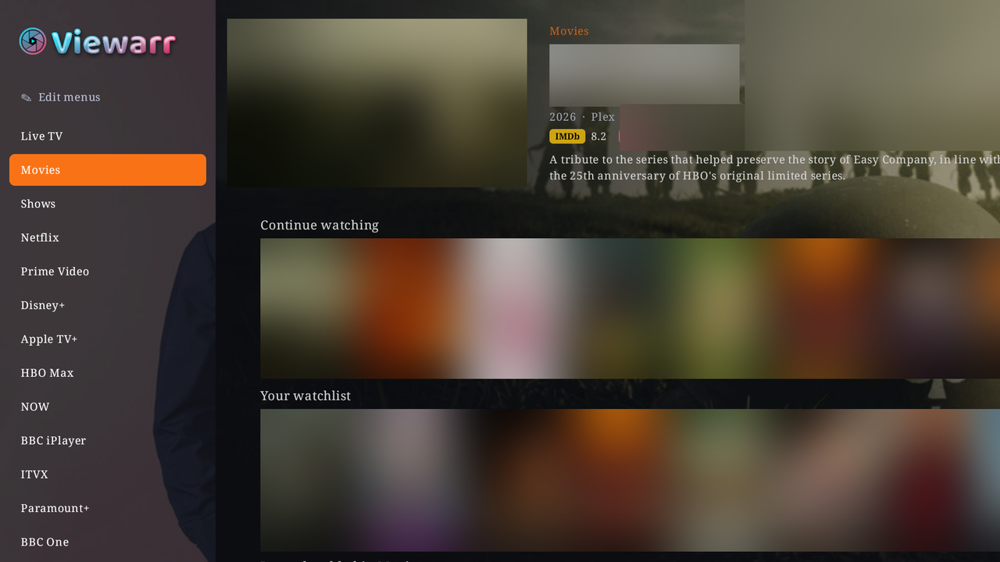
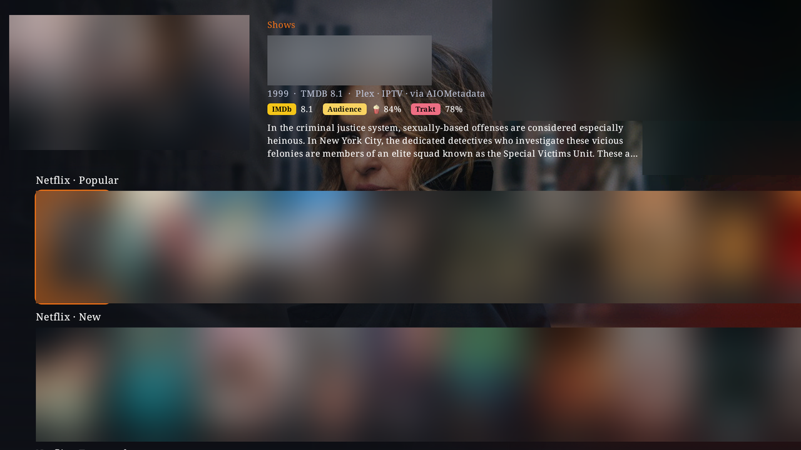
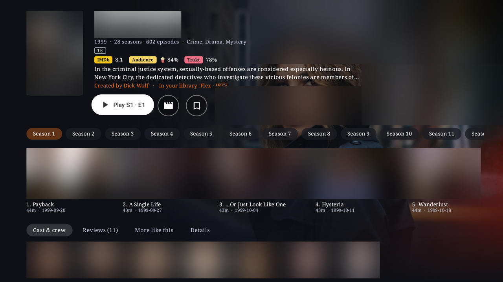

# Films & shows

Films and shows come from your Plex, Jellyfin and Emby servers, from addons you add (such as AIOStreams or AIOMetadata), and from your IPTV provider. TMDB and Trakt are used for discovery. Viewarr doesn't supply any addons or content: you add your own.

## The Movies and Shows pages

Netflix-style rows, with the highlighted title's details at the top and its artwork across the page. Rows include:

- **Continue watching**
- Your **Trakt watchlist** and recommendations
- **Recently added** on your servers
- Trending, popular and top-rated titles from TMDB
- **Upcoming episodes**: when the next episodes of the shows you follow air (from Trakt, or your servers)

Rows that repeat across servers (Continue watching, a library's Recently added) are combined into one. Turn that off with **Combine rows from different servers** in **Settings → Home page & menu**.

If nothing is playing, the highlighted title's trailer plays in the window at the top left (**Settings → Playback → Trailers**).

- **OK** opens a title. **Hold OK** gives a quick menu (watchlist, Seerr request and more).
- **Drop show**: hold OK on a show in Continue watching to drop it, here and on Trakt. Watching it again brings it back.

### Choosing your rows

**Settings → Home page & menu** has one list for **Movies** and one for **Shows**:

1. First, your libraries as the menu lists them: on or off, their order, and their names (hold OK on a library to rename it).
2. Then the rows on the page, top to bottom. Each row says where it comes from (Plex, Jellyfin, AIOMetadata…). These are the same rows the menu's **Jump to a row** lists.

OK turns an entry on or off. Right picks one up so Up / Down move it; OK puts it down.

You can also do this from the menu itself with **Edit menus** (see [Getting around](GETTING-AROUND.md#edit-menus)).

## Your libraries

**Movies** and **Shows** in the menu list your Plex, Jellyfin and Emby libraries, plus **IPTV Movies** and **IPTV Shows** (your provider's films and series through Dispatcharr). IPTV titles get pages found on TMDB by name when the provider gives no id. Your rows are tucked under **Jump to a row**.

- Going into a list slides the one before it away, like the guide's channel groups.
- **Right on a library** lists what you can jump straight into: its categories (IPTV), genres, collections, decades, years, studios or age ratings. Change this in **Settings → Menu & navigation → Right on a library**. OK always opens the whole library.

A library is one continuous grid with:

- **Sort** and **Filter**, built from what your own server offers. Plex lists its own per library, such as genre, decade, network, studio, resolution, HDR / Dolby Vision, Atmos, unwatched and in progress. Jellyfin and Emby have theirs.
- Removable filter chips.
- An **A–Z strip** to jump to a letter.
- Search, with voice.

Each library remembers its sort and filters.

**Several Plex servers**: every server on your Plex account is used, in rows, search and "In your library". Switch any of them off in **Settings → Accounts & sources → Plex**.

## Streaming services

Streaming services and networks (Netflix, BBC One, HBO…) come from your own addons' rows, such as your own **AIOMetadata** instance. Each appears in the menu with its own page.

A service's rows are always in the same order: **New shows**, **New films**, **Originals**, **Popular**, **Top rated**. You can show or hide each row in **Edit menus**, but not reorder them.

## Title pages

A title's page fits on one screen. The header stays put while the seasons, episodes and tabs scroll under it.

- The title's logo, details and description.
- **Ratings** from TMDB, IMDb, Rotten Tomatoes (critics and audience), Metacritic, Letterboxd and Trakt. Each can be on or off, in the order you choose (**Settings → Appearance → Ratings**). IMDb and Rotten Tomatoes come from your Plex when it has them; add a free **MDBList** key in **Settings → Accounts & sources** to get them for every title.
- **Badges**: age rating (UK or US, your choice in **Settings → Appearance → Title pages → Age ratings**), picture (4K, HDR, Dolby Vision), sound (Dolby Atmos, DTS:X, 5.1…), CC, and when a film would end if you started it now.
- **Tabs**: cast & crew (with photos; OK opens their films and shows), reviews from TMDB and Trakt users, more like this, and details.
- Films in a series get a **Collection** tab (for example, the Dune films).
- **Actor pages** show their photo, dates and biography, then their films and shows.

**Settings → Appearance → Title pages** turns each part on or off (each rating, the logo, trailer, episodes row and each tab). Anything off isn't fetched, so pages open faster.

Title logos also show on the Movies and Shows header and in the player. While a film or episode starts, a loading screen shows its backdrop and a gently "breathing" logo.

### One Play button

**Play** plays the best copy you have, in this order:

1. Your servers at home (Plex, Jellyfin, Emby)
2. Your servers away from home
3. Your **addons** (for example AIOStreams)
4. IPTV

A copy whose file has gone is skipped. **Hold OK on Play** to pick the source yourself.

Shows get **Play / Resume S·E**, carrying on from Plex, Jellyfin / Emby or Trakt.

Also on title pages:

- **From the start**: part-way through? A button beside Resume plays it from the beginning.
- **Audio & subtitles**: pick them before Play (films on your Plex, Jellyfin or Emby).
- **Mark watched / unwatched** on your servers and Trakt.

How addon streams are picked is set in **Settings → Playback → Streams**: choose from the list yourself, or let Viewarr start the best cached stream within your quality limit (**Best quality allowed**).

### Seasons and episodes

The seasons and that season's episodes sit on the show's page. It opens on the season you're up to, with watched ticks and progress bars. **OK** plays an episode; **hold OK** to pick its source.

Addons with their own titles (no IMDb or TMDB id, such as fan edits) get proper title pages with their seasons and episodes. Addon TV, sports and event catalogues play straight away.

## Watching

### Player controls

- **OK** brings up the seek bar (with preview pictures) and icon buttons: Play / Pause and Stop, then Details, Audio, Subtitles, Media info, switching player, Search, Transparency and Settings.
- **Hold OK on a button** to arrange them: OK shows or hides one, hold OK picks it up and **Left / Right** move it, **Back** finishes. Play / Pause always stays. It's one arrangement with live TV's controls, so changing either changes both. *(0.28.0 and later.)*
- The remote's **Play/Pause** button pauses.
- The remote's **Info** button (or **Details**) shows the poster, episode and synopsis. These also appear by themselves a moment after you pause.
- **Down**, then **Left / Right** and **OK**: move along the seek bar with preview pictures and jump there. Previews come from Plex, Emby or Jellyfin when the server made them; otherwise the box makes them from the film itself (**Settings → Playback → Seek-bar previews**).
- **OK**, then **Left** on the first button opens the menu over the film.

**Settings → Playback** also sets how long the controls stay up (**Controls stay up for**) and how big they are (**Player controls size**).

### Next episodes

Watching a show, press **Down** to see the next episodes in the info bar, with their release dates. Episodes not out yet are darker and say **Not out yet**. **OK** plays one.

### Skip intro and next episode

- **Skip intro**: a button (OK skips), skipped by itself, or off. Where the intro is comes from Plex, Jellyfin or Emby when they marked it. Otherwise it comes from the community databases TheIntroDB and IntroDB (for addons, IPTV and so on).
- **Skip credits**: during the credits, a **Next episode** button plays the next one straight away (a film just ends).
- **Next episode countdown**: near the end, a card counts down to the next episode. OK plays it now, Back hides the card. Set its length from **No wait** to 180 seconds.
- The next episode always plays when one ends, if **Play next episode automatically** is on.

All are in **Settings → Playback → Episodes**.

### The mini player

- **Back** from a film or episode keeps it playing in the window at the top left while you browse.
- **Back** on that page brings it full screen again.
- **Stop** ends it. Your place is saved.
- The film controls' **Settings** button keeps it playing in the window while you change things.
- **Hold Back** anywhere to choose **Full screen** or **Close**.

**Settings → Playback → After a film or episode** chooses what happens when it ends or you press Stop: stay where you were, or back to live TV.

### The two players

| Player | Good for |
|---|---|
| **Built-in player** (the default) | Light, and passes surround sound to your TV or receiver. |
| **mpv** | Plays almost any file, codec or soundtrack. |

If the built-in player can't play a file, Viewarr switches to mpv by itself at the same moment. You can also switch mid-film from the controls, keeping your soundtrack and subtitles. To use mpv for everything, choose it in **Settings → Playback → Player**.

For smooth playback on weak boxes, mpv draws straight to the screen, the TV can switch to the film's frame rate (**Match frame rate**), and surround passthrough only uses formats your TV or receiver really accepts. See [Troubleshooting](TROUBLESHOOTING.md#picture-and-sound) for more.

**Settings → Playback** also covers audio and subtitle language, surround passthrough, stereo downmix, night mode, subtitle size and colour, resume, and Plex quality. See [Settings](SETTINGS.md#playback).

## Search

Search pops up over any screen: **hold Menu (≡)**, press the remote's search button, or pick a button in **Settings → Remote buttons → Other buttons → Search button**. Back closes it and you're where you were. You can also use **Search** in the menu, which keeps your recent searches.

Search puts what you meant first (a person, a channel, or your own copy of a film) and shows:

- your Plex, Jellyfin and Emby titles in one row,
- people, with their films and shows,
- TV channels and what's on the guide (watch it, record it or get a reminder),
- a **Catch-up** row of programmes from the last few days you can replay (using Dispatcharr's own guide search),
- music, when Music is on.

Quick picks appear as you type. Filters ("pills") at the top bring that kind of result to the top as you move onto them; OK on one filters.

**Voice search**: Viewarr asks for the microphone the first time. It works on the Nvidia Shield too.

## Seerr requests

Connect Seerr (Overseerr / Jellyseerr) in **Settings → Accounts & sources**, with its address and API key (Seerr → Settings → General).

- **Hold OK on a poster** → **Request on Seerr…** for a film or show you don't have yet. This works for addon titles and titles you only have on your IPTV provider too.
- From the TV guide, hold OK on a programme and choose **Request on Seerr…**: a film, or a show's missing episodes. Seasons already on your servers aren't asked for again.

A profile may not be allowed to request (see [Profiles](PROFILES.md)).

## Watchlist

**Settings → Watchlist** chooses which watchlist **Add / Remove** on title pages, the hold-OK menu and the **Your watchlist** row use:

- **Trakt**
- your **Plex** watchlist
- **Jellyfin favourites** or **Emby favourites**

Press OK on it to move to the next choice.

## Trakt

Sign in to Trakt in **Settings → Accounts & sources → Trakt** (a code to approve on your phone).

- Watch progress is sent back to Plex, Jellyfin / Emby and Trakt.
- Your **Trakt watched history** comes back: episodes and films you've watched anywhere get their tick, and Play / Resume carries on from the furthest place any of them knows.
- **Sync with Trakt now** is in **Settings → Accounts & sources → Trakt**, with an optional **Copy watched to Plex** (it marks on your Plex servers what Trakt says you've watched, and never un-marks anything).

## Watch Next

Your Continue watching appears in the Android TV home screen's **Watch Next** row.
