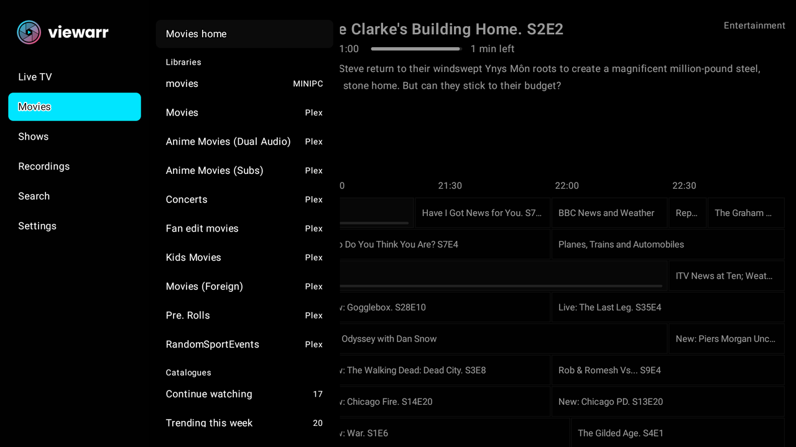
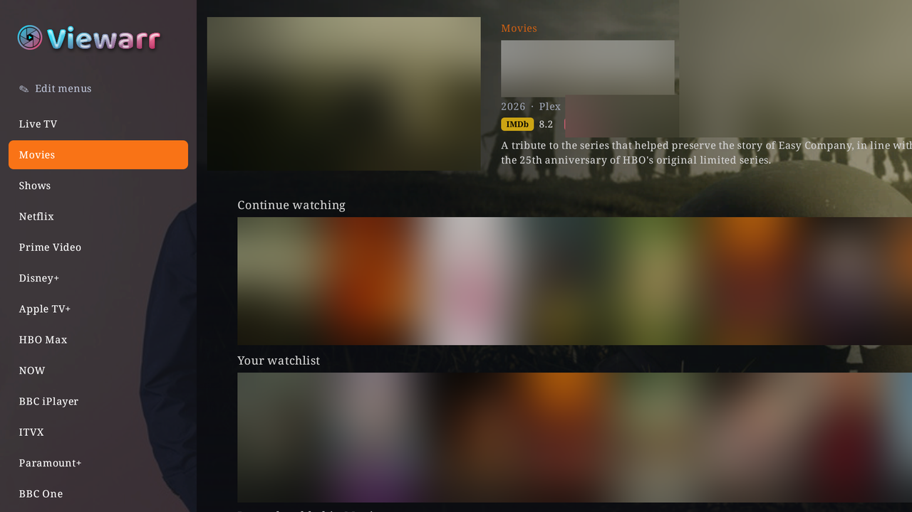

# Getting around

Viewarr has one menu, on the left, made of glass. Whatever is playing keeps going in a window at the top left while you browse. This guide explains how the two work together.

## The glass menu

The menu is see-through on every page. It slides the page and the picture aside rather than covering them.

- **Left** opens the menu from the first poster of any page. In the TV guide, Left goes back a programme and on into catch-up; **Menu (≡)** opens the menu, and with nothing playing so does Back on what's on now (with the Classic preset, Left on what's on now opens the channel groups and **hold Left** goes into catch-up).
- **Up / Down** move through the entries, and the page behind changes straight away: Live TV, Live now, Sports, Movies, Shows, your streaming services (such as Netflix or Disney+), Music and Recordings.
- **Right** (or **OK**) goes into the highlighted entry:
  - **Live TV**: its channel groups. Moving through them changes the guide behind as you go; OK picks one and takes you into the guide.
  - **Movies** and **Shows**: their home page, with your rows tucked under **Jump to a row**.
  - **My Library**: every library on all your servers and your music; moving through them shows each behind. **Left** from a library you opened here goes back to the My Library list, with your place kept.
  - **Recordings**, **Music** and the streaming services: straight into the page.
- **Left** on an entry opens its own list (channel groups, libraries…); **Left** again goes back to the main list.
- **Back** closes the menu from any list, and you stay on the page you were on.

Going into a list slides the one before it away, one panel at a time.

Other ways to reach the menu:

- **Hold Back** on most screens.
- From full-screen live TV, open the channel list (**Up / Down**), then **Left**: the channel groups, and Left again the main menu.
- With a film playing, press **OK**, then **Left** on the first button: the menu opens over the film.

### The hints

- A hint under the logo says what Right does on the highlighted entry ("Right › open its list").
- A hint at the foot of a list says "‹ Left: main menu".
- Each list can have a heading, such as **LIVE TV · CHANNEL GROUPS** or **MOVIES**, or its path (**Live TV › Channel groups**). That way the guide's channel groups are never mistaken for your libraries.

You can change all of these in **Settings → Appearance → Customise → Menu** (see below).

### The top of the menu: ⚙, mic and search

The top of the menu has a **⚙** (that's where **Settings** lives; it isn't in the list itself), a **mic** for voice search and a small **search box**: highlight it and press OK to type straight there, and the search page opens with your results as soon as you send it (it closes again once you pick something). **Up** from Live TV lands on these.

The remote's own mic button works too, once Viewarr is chosen as the TV's voice search app: it opens Viewarr's search, already listening.

### Editing the menu

**Hold OK on any entry** to edit the menu in place, with the page changing as you go:

- Show, hide and reorder the menu's entries and streaming services.
- Show or hide a service's rows.
- Switch Movies' and Shows' libraries and rows on or off, and move them.

When you're done, anything switched off is hidden.

Only want live TV? Switch Movies, Shows and the services off while editing the menu (hold OK on an entry) or in **Settings → Menu & navigation → What the menu lists**.

## The top-left window

Live TV keeps playing in the guide's preview place while you browse Movies, Shows, a service, a library, a title's page, Recordings or Music. The details of whatever you've highlighted sit beside it, with the posters below.

- Nothing playing? The highlighted title's trailer plays there instead (see **Settings → Playback → Trailers**).
- With live TV or a film in the window, the details sit on the right, over the title's artwork; their text gets a soft shade behind it so it stays easy to read on bright pictures.
- **The mini player**: press **Back** while watching live TV or a film and it keeps going top left while you browse. **Back** on the mini player brings it full screen again. **Hold Back**, full screen or mini, closes the player. See [Films & shows](FILMS-AND-SHOWS.md#the-mini-player). With **Settings → Live TV → Customise → Highlight the corner picture** on, pressing towards the window from the edge of a page highlights it too.

## The one info bar

Live TV and films share the same glass info bar. It shows the programme or film, its progress, and the controls' buttons. The bar also says where the picture is coming from (your Plex server, Jellyfin, an addon, IPTV).

Skip intro, the next-episode countdown, reminders and every other pop-up use the same glass. You can change it in **Settings → Appearance → Glass & transparency**:

- **Pop-up glass**: 0% (solid) to 100% (clear) see-through, for the info bar (every style), the player's controls and every pop-up and notice.
- **Info bar: border**: the thin light edge round the glass, on or off.

**Clock on the info bar** (the time at the right of the bar, on live TV and films) is in **Appearance → Info bar & controls**. **Info bar size** and **Preview cards** (how big the bar and the cards in its rows are drawn) are in **Settings → Advanced → Screen & sizes**.

### Info bar styles

Choose how the bar looks in **Settings → Appearance → Info bar & controls → Info bar style**, or add the **Info bar style** button to the bar and press it to try each in turn. The style applies to live TV and films alike.

| Style | What it looks like |
|---|---|
| **Glass** | The Viewarr look: the whole bar in one rounded glass panel, inset from the edges. |
| **Square glass** | The same panel with sharp corners. |
| **Pill** | Fully rounded ends, floating a little higher. |
| **Fade** | No panel: a dark fade up from the bottom, across the whole screen. |
| **Full-width bar** | Edge to edge along the bottom, like a TV box. |
| **Minimal** | Just the text and buttons, with a soft shade behind for reading. |
| **Faded glass** | The glass panel, solid along the bottom and fading to clear at the top, with no hard edge. Unlike Fade, it keeps the bar's width and corners. |
| **Feathered glass** | Glass with no edges at all, melting into the picture on every side. |
| **Side fade** | Dark behind the text on the left, the picture left clear on the right. |
| **Outline** | Almost clear glass with a fine edge in your highlight colour. |
| **Corner card** | A smaller panel in the bottom left, leaving most of the picture clear. |
| **Floating card** | A more solid card lifted off the picture, with a soft shadow under it. |
| **Slim strip** | A thin band along the bottom, with a line of your highlight colour across its top. |
| **Frosted** | Milky light glass instead of the dark tint. |

**Info bar width** and **Info bar corners** (in **Settings → Advanced → Screen & sizes**) apply to the panel styles. Side fade and Corner card are narrower, so if you've added many extra buttons, check they still fit.

## Main menu settings

**Settings → Appearance → Customise → Menu** controls how the menu looks, and **Settings → Menu & navigation → What the menu lists** what it lists.

| Setting | Choices | What it does |
|---|---|---|
| **List headings** | Heading, Off, Path (Live TV › Channel groups) | A heading at the top of each list, or the path to it. |
| **Source in the Live TV heading** | On, Off | With more than one Live TV source, its name goes in the heading ("LIVE TV · DISPATCHARR"). |
| **TV mark on channel groups** | Off, On | A small TV mark before each channel group's name. |
| **Colour edge** | Off, On | A thin bar down each list's edge in your highlight colour. |
| **Colour tint** | Off, On | Each list's glass faintly tinted in its section's colour. |
| **LIVE mark** | Off, On | A red ● LIVE on the channel groups' **All channels**. |
| **Left / Right hints** | On, Off | The "Right › open its list" and "‹ Left: main menu" hints. |

In **Menu & navigation → What the menu lists**, each menu entry (Sports, Movies, Shows, Music, Recordings, Search and each streaming service) can be switched on or off, and so can the **Hidden groups row** at the end of the channel groups. Live TV and Settings are always there. Streaming services appear once your addons' rows have loaded.

## More ways to find your way

- **Button hints**: a small pill at the bottom of the screen says what the buttons do where you are. Choose **First few times**, **Always** or **Off** in **Settings → Menu & navigation → Menu → Button hints**.
- **Settings explain themselves**: a line at the top of Settings describes the highlighted entry, and every section says what it covers.
- **Settings → Menu & navigation** sets where Viewarr opens (**App opens on**) and how poster rows behave. See [Settings](SETTINGS.md#menu--navigation).
- **Search** pops up over any screen: hold **Menu (≡)** or use the remote's search button. See [Films & shows](FILMS-AND-SHOWS.md#search).
- **The tour** from the first run can be seen again any time from **Settings → About → Show the tour**.
