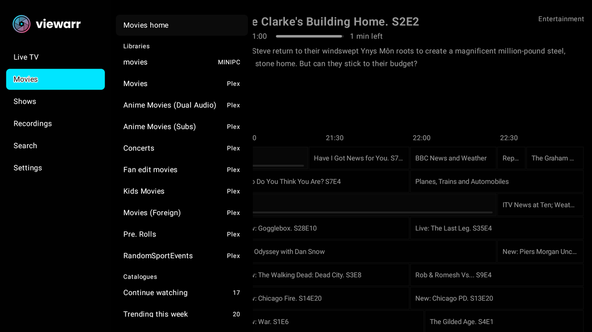
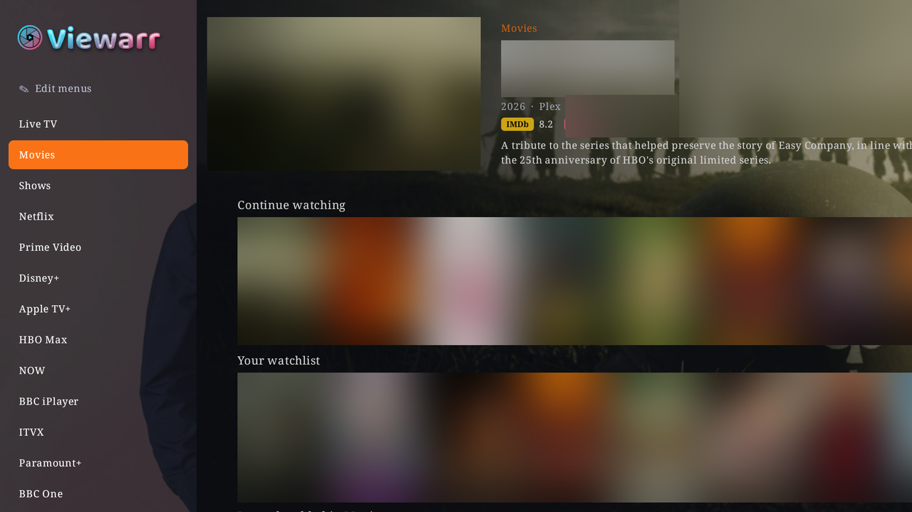

# Getting around

Viewarr has one menu, on the left, made of glass. Whatever is playing keeps going in a window at the top left while you browse. This guide explains how the two work together.

## The glass menu

The menu is see-through on every page. It slides the page and the picture aside rather than covering them.

- **Left** opens the menu. In the TV guide, Left first moves back through the programmes, and opens the menu once you reach the start.
- **Up / Down** move through the entries, and the page behind changes straight away: Live TV, Live now, Sports, Movies, Shows, your streaming services (such as Netflix or Disney+), Music and Recordings.
- **Right** (or **OK**) goes into the highlighted entry:
  - **Live TV**: its channel groups. Moving through them changes the guide behind as you go; OK picks one and takes you into the guide.
  - **Movies** and **Shows**: their home page, with your rows tucked under **Jump to a row**.
  - **My Library**: every library on all your servers and your music; moving through them shows each behind.
  - **Recordings**, **Music** and the streaming services: straight into the page.
- **Left** or **Back** steps back one level at a time. On the main list, Back first goes to **Live TV**, and then closes the menu.

Going into a list slides the one before it away, one panel at a time, as TiviMate does.

Other ways to reach the menu:

- **Hold Back** on most screens.
- From full-screen live TV, open the channel list (**Up / Down**), then **Left**: the channel groups, and Left again the main menu.
- With a film playing, press **OK**, then **Left** on the first button: the menu opens over the film.

### The hints

- A hint under the logo says what Right does on the highlighted entry ("Right › open its list").
- A hint at the foot of a list says "‹ Left: main menu".
- Each list can have a heading, such as **LIVE TV · CHANNEL GROUPS** or **MOVIES**, or its path (**Live TV › Channel groups**). That way the guide's channel groups are never mistaken for your libraries.

You can change all of these in **Settings → Appearance → Menu** (see below).

### Edit menus

**Edit menus** sits at the top of the menu (**Up** from Live TV), with a **⚙** to its left that opens Settings without going to the bottom of the list. Use Edit menus to tidy things up right there, with the page changing as you go:

- Show, hide and reorder the menu's entries and streaming services.
- Show or hide a service's rows.
- Switch Movies' and Shows' libraries and rows on or off, and move them.

When you're done, anything switched off is hidden.

Only want live TV? Switch Movies, Shows and the services off in **Edit menus** or in **Settings → Menu & navigation → What the menu lists**.

## The top-left window

Live TV keeps playing in the guide's preview place while you browse Movies, Shows, a service, a library, a title's page, Recordings or Music. The details of whatever you've highlighted sit beside it, with the posters below.

- Nothing playing? The highlighted title's trailer plays there instead (see **Settings → Playback → Trailers**).
- Films and episodes use the same window. Press **Back** while a film is playing and it keeps going top left while you browse. Back on that page brings it full screen again; **Stop** ends it. See [Films & shows](FILMS-AND-SHOWS.md#the-mini-player).
- **Hold Back** anywhere to choose **Full screen** or **Close** for the picture in the corner. With **Settings → Playback → Highlight the corner picture** on, pressing towards the window from the edge of a page highlights it too.

## The one info bar

Live TV and films share the same glass info bar. It shows the programme or film, its progress, and the controls' buttons. The bar also says where the picture is coming from (your Plex server, Jellyfin, an addon, IPTV).

Skip intro, the next-episode countdown, reminders and every other pop-up use the same glass. You can change it in **Settings → Appearance → Glass & transparency**:

- **Pop-up glass**: from see-through to solid, for the info bar, the player's controls and every pop-up.
- **Info bar: border**: the thin light edge round the glass, on or off.
- **Info bar size** and **Preview cards**: how big the bar and the cards in its rows are drawn.

## Main menu settings

**Settings → Appearance → Menu** controls how the menu looks, and **Settings → Menu & navigation → What the menu lists** what it lists.

| Setting | Choices | What it does |
|---|---|---|
| **List headings** | Heading, Off, Path (Live TV › Channel groups) | A heading at the top of each list, or the path to it. |
| **Source in the Live TV heading** | On, Off | With more than one Live TV source, its name goes in the heading ("LIVE TV · DISPATCHARR"). |
| **TV mark on channel groups** | Off, On | A small TV mark before each channel group's name. |
| **Colour edge** | Off, On | A thin bar down each list's edge in your highlight colour. |
| **Colour tint** | Off, On | Each list's glass faintly tinted in its section's colour. |
| **Icon column** | Off, On | In a section's list, the main menu stays as a narrow column of icons with the one you're in lit, instead of folding away. |
| **LIVE mark** | Off, On | A red ● LIVE on the channel groups' **All channels**. |
| **Left / Right hints** | On, Off | The "Right › open its list" and "‹ Left: main menu" hints. |

Below these, each menu entry (Live now, Sports, Movies, Shows, Music, Recordings, Search and each streaming service) can be switched on or off. Live TV and Settings are always there. Streaming services appear once your addons' rows have loaded.

## More ways to find your way

- **Button hints**: a small pill at the bottom of the screen says what the buttons do where you are. Choose **First few times**, **Always** or **Off** in **Settings → Appearance → Menu → Button hints**.
- **Settings explain themselves**: a line at the top of Settings describes the highlighted entry, and every section says what it covers.
- **Settings → Menu & navigation** sets where Viewarr opens (**App opens on**), where the menu opens (**Menu opens on**), and how poster rows behave. See [Settings](SETTINGS.md#menu--navigation).
- **Search** pops up over any screen: hold **Menu (≡)** or use the remote's search button. See [Films & shows](FILMS-AND-SHOWS.md#search).
- **The tour** from the first run can be seen again any time from **Settings → About → Show the tour**.
