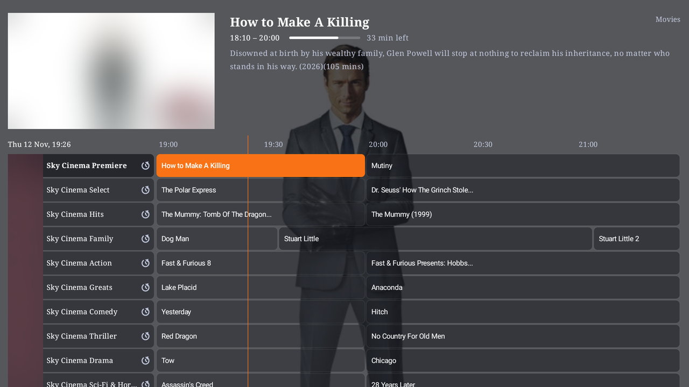
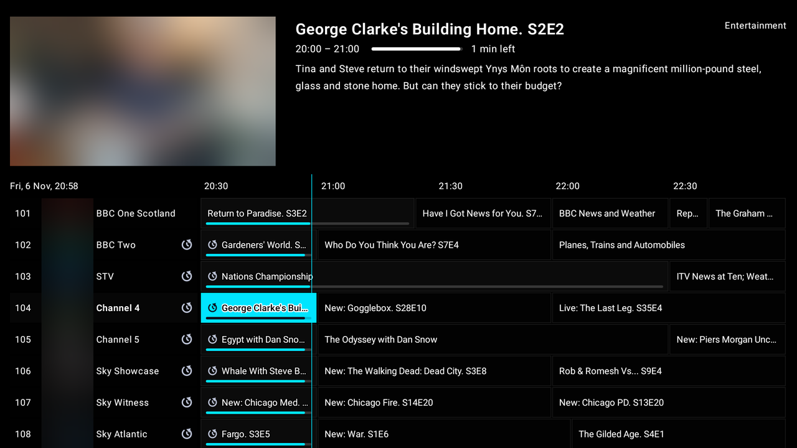

# Live TV

Live TV comes from your own [Dispatcharr](https://github.com/Dispatcharr/Dispatcharr) server, or straight from an IPTV provider's login or an M3U playlist. This guide covers the TV guide, watching, recording, catch-up and sport.

Button names below are the **Viewarr** preset. If you chose the **TiviMate** preset, or changed buttons yourself, see [Remote control](REMOTE.md).

## The TV guide

A TiviMate-style guide with channel logos, categories, and programmes going back and forward in time.

- **OK** on a programme on now: it plays in the preview window at the top left. OK again goes full screen.
- **OK** on a past programme: replay it (catch-up, where the channel has it).
- **OK** on a programme still to come: its details.
- **Hold OK**: more options for that programme (see [Hold OK in the guide](#hold-ok-in-the-guide)).
- **Number keys**: type a channel number.
- **Back** jumps to what's on now, then asks to exit (press Back again).
- **Hold Back** opens the menu on the channel groups. Left again brings the main menu.
- The remote's **Stop** button stops the channel in the preview and leaves you on the guide.

What the guide shows:

- A progress bar under what's on now: on every channel, only the one you're watching, or off (**Settings → Appearance → TV guide → Progress bars**).
- A picture of the highlighted programme at the top: the guide's own artwork from Dispatcharr when it has some, otherwise one found on TMDB. Turn it off with **Programme pictures**.
- **Programme corners**: rounded or square boxes for programmes and channel names.
- **Channel numbers**, **Channel logos** and **Episode numbers** ("S15E4") can each be turned on or off.
- **Catch-up icons**: the replay icon on programmes and channel names, channel names only, or off. Catch-up still works with it off.
- **End of a list**: past the last channel, jump to the other end or stop.

All of these are in **Settings → Appearance → TV guide**.

### Channel groups

Press **Left** from the start of the guide (or **Hold Back**) to see your channel groups. Moving through them changes the guide behind as you go. **OK** picks one and takes you back into the guide. **Left** again brings the main menu.

**Hold OK** on a group to pick it up, then **Up / Down** to move it and OK (or Back) to put it down. Your order is kept for each Live TV source. *(0.28.0 and later.)*

Don't need **All channels**? Hide it in **Settings → Live TV → "All channels" group**. The groups then start with your own, and the guide opens on the first of them.

### Favourites

Hold OK on a channel in the guide (or the full-screen channel list) and choose **★ Add to favourites**. A **★ Favourites** group then heads the channel groups, with just those channels in channel order. **★ Remove from favourites** in the same place takes one out. A channel with nothing listed is added or removed by holding OK straight away.

Favourites are kept on the box for each Live TV source, and shared by everyone who uses it. *(0.28.0 and later.)*

### Hold OK in the guide

Hold OK on a programme for:

- **Record** this programme, or the whole series (every episode, or new ones only).
- **Reminder**: a pop-up when it starts.
- **Start over**: missed the beginning? Viewarr uses the channel's catch-up if it has it. Otherwise it finds the film (or the show's episode) in your Plex, Jellyfin or Emby, or your addons, and plays it from the beginning.
- **Go to show**: opens its page, at the episode you're up to.
- **Search catch-up**: lists every showing you can still replay.
- **Request on Seerr…**: a film, or a show's missing episodes. Seasons already on your servers aren't asked for again.
- **★ Add to favourites** / **Remove from favourites** for the channel.
- **✎ Edit this menu**: choose which of these options the pop-up shows (OK switches each one on or off). Cancelling a recording or a reminder is always there.

A programme already recorded plays with OK.

### Guide refresh

The guide is fetched again from your server while Viewarr is open, and when it starts. Choose how often in **Settings → Live TV → TV guide refresh**: every 2, 4, 8 or 12 hours, once a day, or **Only when I ask**.

To refresh now, use **Settings → Refresh channels & guide**.

### How far ahead

The guide shows **3 days** ahead by default. Change it in **Settings → Live TV → TV guide days ahead**: 1, 3, 5 or 7 days (most guides list 4 to 7). More days take a little longer to fetch and a little more room on the box. A change applies at the next guide refresh. *(0.28.0 and later; before that it was 36 hours.)*

## Watching live TV

- **OK** shows the info bar with the controls: TV guide, stop, audio, subtitles, aspect, source, stream info, record, **Multi-view**, **Transparency** (adjust the see-through levels over the picture), **Settings** and more.
- **Up / Down** opens the channel list over the picture. **Left** from there shows the channel groups.
- **Right** on a channel in the list shows its programmes, earlier and coming up. Earlier ones play from catch-up.
- **Channel + / −** changes channel.
- **Number keys** type a channel number.
- **Back** glides the channel into the guide's preview. **Back twice quickly** always exits.
- **Stop** stops the channel and leaves you on the guide.

### The info bar

The info bar shows the channel, what's on now and next, and badges for the stream. Change it in **Settings → Appearance → Info bar & controls**:

- **Pop-up glass**: from see-through to solid. Every pop-up follows it.
- **Info bar: border**, **Info bar: channel number** and **Info bar: episode numbers**: each on or off.
- **Info bar: picture quality**: badges for the picture (HD · FHD · 4K, or 720p · 1080p · 2160p, or off) and 5.1 sound.
- **Info bar: frame rate**: a badge with the stream's frames per second.
- **Info bar size**: Normal, Compact, Small or Large. Smaller covers less of the picture.
- **Preview cards**: the size of the cards in the bar's rows (next episodes, shortcuts).

### Arranging the info bar's buttons

Hold OK on any button in the controls (OK while watching) to edit them, right there:

- **OK** shows or hides the highlighted button (hidden ones are dimmed while you edit).
- **Hold OK** picks it up; **Left / Right** move it; OK puts it down.
- **Back** (or **Done** at the end) finishes.

**Extra buttons** show in edit mode marked *not added*: OK adds one (OK again removes it). They are **Favourite** (add or remove this channel), **Last channel**, **Audio sync** (the sound up to 300 ms earlier or later, starting from Settings → Playback → Lip sync), **Sleep timer** (each press: 15, 30, 60 or 90 minutes, the end of the programme, off; then everything stops), **Movies**, **Shows** and **Recordings** (the page, with the channel in the corner), **TV settings** (frame rate matching, picture size, deinterlace, surround passthrough, channels, night mode and volume boost, changed over the picture with OK, with the TV's current mode shown at the top), and for films **Episodes** (the next episodes row).

The TV guide button always stays. The arrangement is shared with the film and episode controls, so both bars stay the same; live TV's extras (Aspect, Source, Record, Multi-view) keep their places in it, and you can edit it from either bar. *(0.28.0 and later.)*

### Browsing channels in the info bar

The easy way: **Settings → Live TV → Up / Down while watching** → *Browse in the info bar, OK changes* (or *…changes when you stop*). Up / Down and Channel + / − then move the info bar through the channels while the picture stays put; **OK** changes to the one shown, **Back** stays where you were. *(0.28.0 and later.)*

You can look through channels without changing the picture:

1. In **Settings → Remote buttons**, set a button on live TV (for example **Up** or **Down**) to **Next channel in the info bar** or **Previous channel in the info bar**.
2. While watching, that button shows each channel and what's on it in the bar, while the picture stays put.
3. The channel changes when you stop on one.

Choose how long to rest on a channel in **Settings → Live TV → Browsing channels**: 0.3 to 2 seconds, or **Only when I press OK**. OK always changes straight away; Back stays on the channel you were watching.

### Quick zapping

Passing over channels doesn't start each one on Dispatcharr, so you don't use up your provider's connections. Only the channel you stop on starts. Set how long a channel must stay chosen in **Settings → Remote buttons → Other buttons → Channel change delay** (No wait, up to 2 seconds).

A channel that stalls is asked for again by itself.

### Still watching?

**Settings → Playback → Still watching?** asks whether you're still there after 2, 3, 4 or 6 hours without a button press. If nobody answers within a minute, live TV stops. This frees a provider connection when the TV's been left on.

## Pause, rewind and catch-up

On channels with catch-up (using Dispatcharr's catch-up):

- **Pause**, then carry on from that moment.
- **Rewind** with **Left** ("Rewind?" asks first). **Right** skips ahead.
- Or press **OK**, go **Up** to the progress bar and move a marker back to where you want to jump to.
- Fast-forward back to live, or press **Go live**.

The seek bar shows where you're playing and how far through the programme live is. **Settings → Remote buttons → Other buttons → Skip size** sets how far each skip goes.

**Catch-up** also lets you replay programmes from the past: press OK on one in the guide, or Right on a channel in the channel list. Search finds them too: a **Catch-up** row lists programmes from the last few days you can replay.

## Recordings

Recordings are made on your Dispatcharr server.

- **Hold OK** on a programme in the guide: record that programme, or a whole series (every episode, or new ones only). A red dot marks what's set to record.
- **One-press record**: the remote's **Record** button records what's on (or the highlighted programme in the guide) straight away.
- **Recordings** in the menu lists what's recorded and scheduled. Watch, stop or delete recordings from there.
- Small cards tell you when a recording starts, finishes or fails.

To record, your Dispatcharr user needs **DVR access: Manage** (Dispatcharr → Users → edit user). If a profile isn't allowed to record, the options don't work for them (see [Profiles](PROFILES.md)).

## Reminders

Set a reminder from the hold-OK menu in the guide, or from search. You get a pop-up when the programme starts.

## Multi-view

Watch up to four channels at once: **OK** while watching → **Multi-view**.

- The arrows move between windows. The sound follows the one you've selected.
- **OK** makes a window full screen.
- **Hold OK** changes or removes a window.

Each window counts as a stream on your provider. Dispatcharr's failover to a backup provider works per window. Multi-view is off in low-memory mode.

## Source switching and stream info

*(Dispatcharr admin users only.)*

- **Source**: see every stream behind a channel (and which provider it's from) and switch Dispatcharr to another one from the remote.
- **Stream info**: Dispatcharr's live view of the channel: source, provider, resolution, codecs, bitrate and viewers.

Both are in the live TV controls (**OK** while watching).

## Live now

**Live now** in the menu lists what's on the sport and event channels now and starting soon. Match pictures come from TheSportsDB.

## Sports

Follow teams and leagues, and Viewarr shows their games and the channel showing each.

**Set it up** in **Settings → Sports**:

- Type a team, league or sport (for example "Premier League" or "golf"), or
- Pick a sport, then a league, then a team. You can also **Follow the whole league**.

ESPN's data covers almost every competition.

**Sports** in the menu then shows the games as panels with both teams' badges: what's on now first, then a row per team or league. **OK** on a game goes to the channel showing it:

- your own guide (including the **EPG & Sports Editor** plugin's event listings),
- the UK listings, or
- an event channel named after the match.

With the **UK Sport on TV** Dispatcharr plugin installed, games show their UK channel weeks ahead, and games not on UK TV show the club channel that streams them.

## Dispatcharr plugins

*(Dispatcharr admin users only.)*

In **Settings → Dispatcharr plugins** you can:

- switch installed plugins on and off,
- press their action buttons,
- change simple settings (others are changed on Dispatcharr's web page),
- install or update plugins from your server's plugin store (**Get plugins**).

Plugins run code on your Dispatcharr server, so install ones you trust. ✓ marks a signed, official repository.

## Without Dispatcharr: Xtream and M3U

No Dispatcharr? You can still use Viewarr for live TV:

- Sign in with your **IPTV provider's (Xtream Codes) login** for channels, guide, catch-up and the provider's films and series.
- Or add an **M3U playlist** link, with an optional XMLTV guide (EPG) link.

For logins and playlists, **Choose groups** leaves out groups you never watch, so their channels and guide aren't stored on the TV.

Recordings, source switching, stream info, plugins and profiles need Dispatcharr.

## Several sources

You can save more than one Live TV source: several Dispatcharr servers, IPTV logins or playlists.

- Name each one (for example "Backup provider").
- Switch between them from the guide's menu, or from full screen (**Up**, **Left**, **Left**).
- The three most recent keep their guide on the box, so switching is instant.

**Settings → About** lists your Live TV sources and when each guide was last updated.

## After a film

**Settings → Playback → After a film or episode** can take you back to live TV, on the channel you were watching, when a film ends or you stop it.

## Controlling live TV from outside

Home automation, a web page on your server or ADB can change channel, stop, record and more with `viewarr://` links. See [Controlling Viewarr from outside](AUTOMATION.md).
