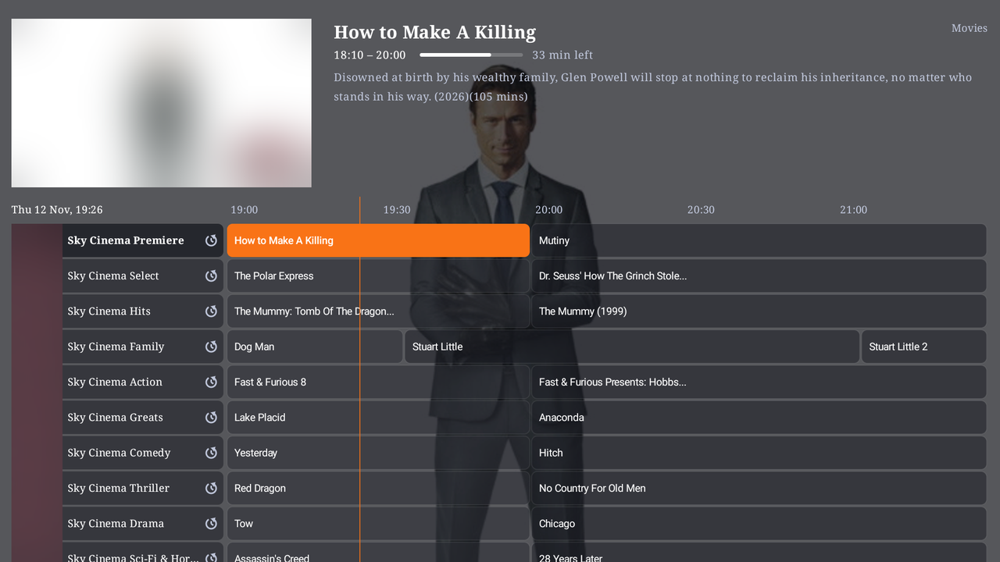
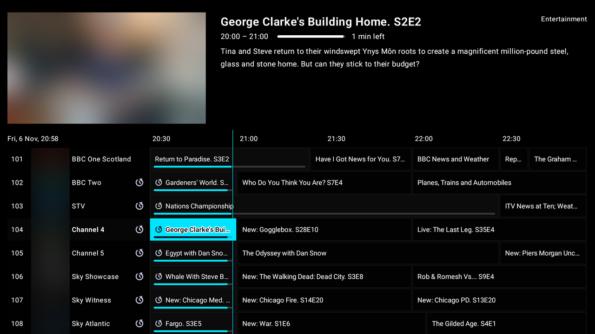

# Live TV

Live TV comes from your own [Dispatcharr](https://github.com/Dispatcharr/Dispatcharr) server, or straight from an IPTV provider's login or an M3U playlist. This guide covers the TV guide, watching, recording, catch-up and sport.

Button names below are the **Viewarr** preset. If you chose the **Classic** preset, or changed buttons yourself, see [Remote control](REMOTE.md).

## The TV guide

A classic IPTV-style guide with channel logos, categories, and programmes going back and forward in time.

- **Long programme names scroll** on the highlighted programme, so they can be read in full. *(0.28.7 and later.)*
- **The info panel** at the top shows the channel, the times, what's on next and the programme's badges. *(0.29.0 and later.)*
- **Cleaner cells**: very short programmes are merged into their neighbours, with small gaps between programmes and rounded rows. *(0.29.0 and later.)*

### Guide times out by an hour or more

When a provider's guide is hours out (another time zone, or summer time handled wrongly), move it:

- **The whole source**: Settings → Live TV → Customise → **EPG offset**, from −12 h to +12 h in half hours.
- **Only some channels**: hold OK on one in the guide → **EPG offset**, then + / − 30 minutes or an hour (channels sharing its guide move with it). The offset shows in that menu, not beside the channel's name.
- **M3U playlists**: a channel's own `tvg-shift` is used by itself.

The listings move straight away, and the times are right everywhere: the guide, the info bar, reminders, recordings sent to Dispatcharr and catch-up. Dispatcharr's own series rules still record by its own guide's times. *(0.28.9 and later.)*

- **OK** on a programme on now: it plays in the preview window at the top left. OK again goes full screen.
- **OK** on a past programme: replay it (catch-up, where the channel has it).
- **OK** on a programme still to come: its details.
- **Hold OK**: more options for that programme (see [Hold OK in the guide](#hold-ok-in-the-guide)).
- **Number keys**: type a channel number.
- **Left** goes back a programme, and carries on into catch-up (tap or hold; it stops at the start of catch-up). With the **Classic** preset, Left on what's on now opens the channel groups instead, and **hold Left** goes into catch-up.
- **Menu (≡)** opens the main menu. **Play / pause** or **Info** shows the programme's details.
- With a channel in the preview window: **Back** takes it full screen, **Hold Back** closes the player.
- With nothing playing: **Back** jumps to what's on now, then opens the menu; **Hold Back** opens the menu on the channel groups.
- The remote's **Stop** button stops the channel in the preview and leaves you on the guide.

What the guide shows:

- **How much time**: Settings → Appearance → TV guide → **Timeline** shows 1½ to 6 hours across the screen (2½ as standard).
- A progress bar under what's on now: on every channel, only the one you're watching, or off (**Settings → Appearance → TV guide → Progress bars**).
- A picture of the highlighted programme: the guide's own artwork from Dispatcharr when it has some, otherwise one found on TMDB. Turn it off with **Programme pictures**. **Programme picture shows as** chooses **Background** (it fills the screen behind the guide) or **Banner** (a picture card beside the programme's details).
- **Elapsed shading**: on a programme that's on now, the part that's already gone is lightly shaded up to the time line.
- **Programme corners**: rounded or square boxes for programmes and channel names.
- **Channel numbers**, **Channel logos** and **Episode numbers** ("S15E4") can each be turned on or off.
- **Catch-up icons**: the replay icon on programmes and channel names, channel names only, beside the highlighted channel only, or off. Catch-up still works with it off.
- **Channel rows**: how many channels fit on screen (10, 12, 9 or 8). This one is in **Settings → Advanced → Screen & sizes**.
- **End of a list**: past the last channel, jump to the other end or stop. This one is in **Settings → Live TV → Customise**.

The rest are in **Settings → Appearance → TV guide**.

### Channel groups

Press **Left** on what's on now to see your channel groups. Moving through them changes the guide behind as you go. **OK** picks one and takes you back into the guide. **Left** again brings the main menu.

**Hold OK** on a group for **↕ Move** (then Up / Down, and OK or Back to put it down) or **✕ Hide from this list**; ★ Favourites and All channels can be hidden the same way. Hidden groups gather at the end under **Hidden groups**; OK on one shows it again. Don't want that row? Turn off **Settings → Menu & navigation → Hidden groups row**, and hold OK on any group → **Show hidden groups** instead. Hiding only takes it out of the list: its channels stay in All channels, by number and in links. Your order and hidden groups are kept for each Live TV source. *(0.28.1 and later.)*

Don't need **All channels**? Hide it in **Settings → Live TV → "All channels" group**. The groups then start with your own, and the guide opens on the first of them.

**Event channels** (TNT events, live football slots, pay-per-view and the like) are mostly empty slots. With **Settings → Advanced → TV guide data → Event channels: only with a listing** on (it's off to start with), an event channel is listed only while the guide has something on it now or starting within the next 24 hours, and a group of nothing but empty event channels disappears until one of them has a listing. This is the same everywhere a channel is listed: the Live TV hub, the guide and its channel groups, the full-screen channel list, favourites and typed channel numbers. Reminders, recordings, links and the Sports page still reach a hidden channel, so a game the plugin puts on one still plays. Club TV channels always show. Off: every event channel, all the time. With the [Viewarr plugin](#viewarr-plugin-optional), the plugin picks out the event groups; without it, the TV spots them by their names. *(0.29.1 and later; without the plugin, 0.29.5 and later.)*

### Favourites

Hold OK on a channel in the guide (or the full-screen channel list) and choose **★ Add to favourites**. A **★ Favourites** group then heads the channel groups, with just those channels in channel order. **★ Remove from favourites** in the same place takes one out. A channel with nothing listed is added or removed by holding OK straight away.

Favourites are kept on the box for each Live TV source, and shared by everyone who uses it. *(0.28.0 and later.)*

### Hold OK in the guide

Hold OK on a programme for:

- **Record** this programme, or the whole series (every episode, or new ones only).
- **Reminder**: a pop-up when it starts.
- **Start over**: missed the beginning? Viewarr uses the channel's catch-up if it has it. Otherwise it finds the film (or the show's episode) in your Plex, Jellyfin or Emby, or your addons, and plays it from the beginning.
- **Go to show**: opens its page, at the episode you're up to.
- **Search catch-up**: lists every showing you can still replay.
- **Request on Seerr…**: a film, or a show's missing episodes. Seasons already on your servers aren't asked for again.
- **★ Add to favourites** / **Remove from favourites** for the channel.
- **✎ Edit this menu**: choose which of these options the pop-up shows (OK switches each one on or off). Cancelling a recording or a reminder is always there.
- **⚑ Report a problem…**: see [Report a problem](#report-a-problem).

A programme already recorded plays with OK.

### Report a problem

Viewarr also reports by itself: when none of a channel's sources will play, a "No picture / dead stream" report goes in automatically (once an hour per channel), and a source that didn't start is shared with the plugin within half a minute so the house's stream order learns from it.

Hold OK on a channel (in the guide, the channel list, the player's menu or a channel card in the Live TV hub) → **Report a problem…**. The same menu, wherever you are:

- **Wrong programme guide**: the channel shows another channel's listings. A search opens with the channel's name filled in, listing your Dispatcharr's guides (each with its source): pick the right one, or **Skip, just report it**. Admins' picks are applied straight away; everyone else's go to the [Viewarr plugin](#viewarr-plugin-optional), which changes the channel's guide for the whole house. If the plugin can't tell which guide is right, the reporter (and admins) get a card to choose one, and the channel is listed under **Needs your pick** in Settings → Live TV → Reports.
- **Guide times are out**: the usual EPG offset slider; the offset you set goes with the report, and the plugin can make it the house's offset for that channel (every TV without an offset of its own for it then uses it).
- **No picture / dead stream**: the stream playing (when Viewarr knows which) is reported, and this TV moves it down its own order at once.
- **Wrong logo**, **Wrong name** (type or say the right one) and **Something else** (an optional note).

Each report is confirmed with "Reported · channel" (and "applied" when it took effect at once). The plugin acts on reports automatically and logs every change; **Settings → Live TV → Reports** lists them newest first, and an admin can **Undo** any of them there (or from the quiet card that comes up when a change is made, with **Notifications → Reports from the house** on). Your own reports are listed too.

Without the plugin, reports stay on the TV (the last 50, for two weeks) and the Reports page says so; nothing is lost, and they're sent as soon as the plugin is there.

### Guide refresh

The guide is fetched again from your server while Viewarr is open, and when it starts. Choose how often in **Settings → Advanced → TV guide data → TV guide refresh**: every 2, 4, 8 or 12 hours, once a day, or **Only when I ask**.

To refresh now, use **Settings → Refresh channels & guide**.

### TV guide sources

*(Dispatcharr admin users only.)*

**Settings → Live TV → TV guide sources** lists the guide (EPG) sources on your Dispatcharr server: each one's name, type (XMLTV, Schedules Direct or Dummy), when it was last updated (or "Updating…", or what went wrong) and an On / Off switch. OK on a source:

- **Switch on** / **Switch off**,
- **Update now**: Dispatcharr fetches it again (the list shows how it's going),
- **Rename** and **Change address** (the XMLTV link),
- **Refresh interval**: every 6, 12 or 24 hours, every 2 days, or never,
- **Delete** (asks first).

At the bottom, **Add a guide source** takes an XMLTV link or a Schedules Direct account (choose its lineups on Dispatcharr's web page), then offers **Update now**; **Update all now** fetches every source that's on. Sources filled in by a Dispatcharr plugin can be switched, renamed or deleted, but the plugin updates them. Changes are for everyone on the server.

### How far ahead

The guide shows **3 days** ahead by default. Change it in **Settings → Advanced → TV guide data → TV guide days ahead**: 1, 3, 5 or 7 days (most guides list 4 to 7). More days take a little longer to fetch and a little more room on the box. A change applies at the next guide refresh. *(0.28.0 and later; before that it was 36 hours.)*

## Watching live TV

- **OK** shows the info bar with the controls: TV guide, stop, audio, subtitles, aspect, source, stream info, record, **Multi-view**, **Refresh guide** (fetches the TV guide again now), **Transparency** (adjust the see-through levels over the picture), **Settings** and more.
- **Up / Down** opens the channel list over the picture. **Left** from there shows the channel groups.
- **Right** on a channel in the list shows its programmes, earlier and coming up. Earlier ones play from catch-up.
- **Channel + / −** changes channel.
- **Number keys** type a channel number.
- **Back**: the mini player. The channel glides into the guide's preview window and keeps playing; **Back** there brings it full screen again.
- **Hold Back** closes the player.
- **Stop** stops the channel and leaves you on the guide.

### The info bar

The info bar shows the channel, what's on now and next, and badges for the stream. Change it in **Settings → Appearance → Info bar & controls**:

- **Info bar: channel number** and **Info bar: episode numbers**: each on or off.
- **Info bar: picture quality**: badges for the picture (HD · FHD · 4K, or 720p · 1080p · 2160p, or off) and 5.1 sound.
- **Info bar: frame rate**: a badge with the stream's frames per second.

**Pop-up glass** (0% solid to 100% clear; the info bar and every pop-up follow it) and **Info bar: border** are in **Appearance → Glass & transparency**. **Info bar size** (Normal, Compact, Small or Large), **Info bar width**, **Info bar corners** and **Preview cards** (the size of the cards in the bar's rows; live TV and films use the same size) are in **Settings → Advanced → Screen & sizes**.

### Rows under the info bar

Press **Down** from the info bar's buttons for rows of channels and titles to jump to. You choose which rows, and their order, separately for live TV and for films & shows, in **Settings → Appearance → Info bar & controls → Rows under the info bar** (Up to switch between Live TV and Films & shows; OK turns a row on or off; hold OK and Up / Down to move one; a preview shows how they'll look).

- **On live TV**: Continue watching (everything together, or just IPTV, Trakt, or Plex / Jellyfin), **Recent channels** (on to start with), **Favourite channels**, **On now in this group**, **Coming up on this channel**, Recordings, Recently added and Your watchlist.
- One row shows at a time, with **2 of 4** beside its name. **Down / Up** move between rows, **Left / Right** along one, **OK** watches or opens it, **Back** returns to the buttons. Rows with nothing in them are left out.
- From a film, picking a channel stops the film and switches to it. *(0.28.2 and later.)*

### Arranging the info bar's buttons

Choose the buttons in **Settings → Appearance → Info bar buttons** (or hold OK on any button in the controls for the same list): every button by name, ticked if it's on the bar. *(0.28.9 and later.)*

- **OK** puts a button on the bar or takes it off.
- **Right** picks one up; **Up / Down** move it; Right again puts it down.
- **TV guide, Play / Pause, Stop, Audio and Subtitles** are always on the bar. They can be moved, not removed.

**Extra buttons** start off the bar. They are **Favourite** (add or remove this channel), **Last channel**, **Audio sync** (the sound up to 300 ms earlier or later, starting from Settings → Advanced → Audio sync), **Sleep timer** (each press: 15, 30, 60 or 90 minutes, the end of the programme, off; then everything stops), **Movies**, **Shows** and **Recordings** (the page, with the channel in the corner), **Info bar style** (each press switches the bar to the next style: Glass, Square, Pill, Fade, Full-width, Minimal), **TV settings** (frame rate matching, picture size, deinterlace, surround passthrough, channels, night mode and volume boost, changed over the picture with OK, with the TV's current mode shown at the top), and for films **Episodes** (the next episodes row).

The TV guide button always stays. The arrangement is shared with the film and episode controls, so both bars stay the same; live TV's extras (Aspect, Source, Record, Multi-view) keep their places in it, and you can edit it from either bar. *(0.28.0 and later.)*

### Browsing channels in the info bar

The easy way: **Settings → Live TV → Up / Down while watching** → *Browse in the info bar, OK changes* (or *…changes when you stop*). Up / Down and Channel + / − then move the info bar through the channels while the picture stays put; **OK** changes to the one shown, **Back** stays where you were. *(0.28.0 and later.)*

You can look through channels without changing the picture:

1. In **Settings → Remote buttons**, set a button on live TV (for example **Up** or **Down**) to **Next channel in the info bar** or **Previous channel in the info bar**.
2. While watching, that button shows each channel and what's on it in the bar, while the picture stays put.
3. The channel changes when you stop on one.

Choose how long to rest on a channel in **Settings → Live TV → Customise → Browsing channels**: 0.3 to 2 seconds, or **Only when I press OK**. OK always changes straight away; Back stays on the channel you were watching.

### Quick zapping

Passing over channels doesn't start each one on Dispatcharr, so you don't use up your provider's connections. Only the channel you stop on starts. Set how long a channel must stay chosen in **Settings → Remote buttons → Other buttons → Channel change delay** (No wait, up to 2 seconds).

A channel that stalls is asked for again by itself.

### Still watching?

**Settings → Live TV → Customise → Still watching?** asks whether you're still there after 2, 3, 4 or 6 hours without a button press. If nobody answers within a minute, live TV stops. This frees a provider connection when the TV's been left on.

## Pause, rewind and catch-up

On channels with catch-up (using Dispatcharr's catch-up), and on every channel with Live timeshift (below):

- **Pause**, then carry on from that moment.
- **Rewind** with **Left** ("Rewind?" asks first). **Right** skips ahead.
- Or press **OK**, go **Up** to the progress bar (a dot shows you're on it) and move a marker back to where you want to jump to.
- Fast-forward back to live, press **Go live** (OK then Down lands on it), or **hold Play / pause**.

The seek bar shows where you're playing and how far through the programme live is. **Settings → Remote buttons → Other buttons → Skip size** sets how far each skip goes.

### Live timeshift (with the Viewarr plugin)

With the [Viewarr plugin](https://github.com/petebutty/viewarr-plugin) 0.6.3 or later, every live channel can be paused and rewound, **with or without catch-up**: your server keeps a rolling copy of the channel you're watching (2 hours to start with), from Dispatcharr's own stream, so it needs no extra connection to your provider.

- Pause and Play carry on from the paused moment; Left steps back instantly through what you've watched since tuning in; Right or **Go live** brings you back to live.
- Further back than the buffer, a channel with catch-up uses the provider's catch-up as before.
- The copy is deleted as soon as you change channel or stop. Two TVs on the same channel share one copy.
- **Settings → Live TV → Customise → Live timeshift** switches it off for you. The buffer length, how many channels at once, and the whole feature are in **Settings → Plugins → Viewarr** (admins).
- Tip: **Settings → Remote buttons → Live TV**: set **Left** to **Skip back** and **Right** to **Skip forward** to rewind and skip with the arrows while watching full screen.

**Catch-up** also lets you replay programmes from the past: press OK on one in the guide, or Right on a channel in the channel list. Search finds them too: a **Catch-up** row lists programmes from the last few days you can replay.

## Recordings

Recordings are made on your Dispatcharr server.

### Recording something

- **Hold OK** on a programme in the guide: record that programme, or a whole series (every episode, or new ones only). A red dot marks what's set to record.
- **One-press record**: the remote's **Record** button records what's on (or the highlighted programme in the guide) straight away.
- **Sport**: **Record** or **Record all …** (for example **Record all Celtic**) on a game, or **Record when it's in the guide** for a game no channel lists yet (see [Sports](#sports)).
- Small cards tell you when a recording starts, finishes or fails.

To record, your Dispatcharr user needs **DVR access: Manage** (Dispatcharr → Users → edit user). If a profile isn't allowed to record, the options don't work for them (see [Profiles](PROFILES.md)).

### The Recordings page

**Recordings** in the menu has three tabs: **Recorded · Scheduled · Series recordings**. It opens on **Recorded** the first time, then on the tab you used last.

- Each tab shows its date order beside its name: Recorded **newest first** or **oldest first**, Scheduled **soonest first** or **latest first**, Series recordings **next first** or **furthest first**. **OK** on the tab you're on turns its order round. Viewarr remembers each tab's order.
- **Recorded** is organised with TMDB into **Shows**, **Films** and **Sport & other** (matches, news and anything TMDB doesn't know), with posters and episode names. Each show's episodes are grouped together ("Shetland · 3 episodes"): **OK** opens or closes the group.
- **Scheduled** has anything recording now at the top, then what's coming up.
- **Series recordings** lists your series rules by readable names (such as "Celtic games"), each with **Every episode** or **New episodes**.
- **OK** plays a recording. **Hold OK** for its options: **Delete recording…** (it asks first), **Stop recording**, **Cancel recording**, or **Remove from list** for one that failed.

### Watching recordings

- A recording you've started shows a progress bar, a tick once it's watched, and plays on from where you stopped.
- Recordings you've started, and new ones from the last week you haven't played yet, appear in **Continue watching** on the Shows page, with the show's or film's poster. Pressing one plays it straight away.
- Recordings matched on TMDB are sent to **Trakt** like any film or episode (start, pause and stop), when **Settings → Playback → Watch progress → Send plays to Trakt** is on. They appear in your Trakt history and Continue watching.
- A film's recording is listed in **Play from** on its title page (hold OK on Play), with your other copies.

## Reminders

Set a reminder from the hold-OK menu in the guide, from search, or with **Remind me** on a game. Games with a reminder set show 🔔.

Reminder pop-ups are **off** until you turn them on, in **Settings → Menu & navigation → Notifications**: switch on **Notifications**, then **Reminders**. **Remind me** there sets how early it comes up: when it starts, or 2, 5, 10 or 15 minutes before. *(0.29.0 and later.)*

## Multi-view

Watch up to four channels at once: **OK** while watching → **Multi-view**.

- The arrows move between windows. The sound follows the one you've selected.
- **OK** makes a window full screen.
- **Hold OK** changes or removes a window.

Each window counts as a stream on your provider. Dispatcharr's failover to a backup provider works per window. Multi-view is off in low-memory mode.

## Source switching and stream info

*(Dispatcharr admin users only.)*

- **Source**: see every stream behind a channel (and which provider it's from) and switch to another one from the remote. Viewarr decides how before switching, from Dispatcharr's own count of each provider's connections:
  - **A connection free at that provider**: gap-free. The channel keeps playing while the new stream opens, then it swaps in.
  - **None free** (a backup allowing one connection, already in use, or an account allowing one): the stream playing is let go first, then the new one starts, so the provider never sees two (a loading screen of a second or two).
  - A provider that turns out to allow fewer connections than it says is remembered on the TV (for a week), and switched the safe way.
  - If a stream can't start, you're back on the channel with a note saying why.
  - The list shows each stream's quality from Dispatcharr's last check (for example **1080p · 25 fps · H264**) and marks streams that can't play right now: **⚠ busy** (its provider has no connection free), **⚠ didn't start just now**, **⚠ gone from the provider's list**.
  - While you watch, Viewarr keeps an eye on the stream through Dispatcharr: if no new picture comes in for about 20 seconds, a note says the source is struggling and how to try another.

  While on a stream you picked, Dispatcharr's own automatic failover doesn't watch it; changing channel goes back to normal. *(0.28.9 and later.)*
- **Start with the best source** (Settings → Live TV, on to start with): a channel with several streams behind it starts on the best one, not always Dispatcharr's first. Best means the highest quality (Dispatcharr's own check of each stream, or the FHD / HD / SD in its name; 4K last, as most lines can't carry it), with streams that failed lately after the rest and Dispatcharr's own order to break ties. A stream that doesn't start, can't be read, or keeps stopping is remembered as failed on the TV for a day (three fails in a week: all week), and the next best plays instead; one that plays for a minute is remembered as good. When the best is Dispatcharr's own first stream the channel plays as normal, so Dispatcharr's failover still watches it. The Sources list shows the same order, with **★ best** on the top one. *(0.29.1 and later.)*
- **The provider on the info bar**: where the channel's stream is coming from (your provider, or a backup), always shown; Settings → Appearance → **Info bar: source** turns it off.
- **Stalled streams**: live TV stuck loading for 8 seconds after it had been playing (Dispatcharr moving to a backup, a provider hiccup) reconnects by itself.
- **Stream info**: Dispatcharr's live view of the channel: source, provider, resolution, codecs, bitrate and viewers.

Both are in the live TV controls (**OK** while watching).

## Live now

**Live now** in the menu lists what's on the sport and event channels now and starting soon, including NBA and other US games. Match pictures come from TheSportsDB.

Choose what it shows in **Settings → Live TV**:

- **Live now groups**: which channel groups it looks through.
- **Live now** *(0.29.1 and later)*: your list of teams, leagues and sports. Empty (as it starts): Live now shows everything live. **Add a team, league or sport** opens a search: type a name, or press Down for the sport buttons (a sport's button offers the whole sport, darts, snooker and racing included, and its leagues; a league can show its teams). OK adds it, and Live now then shows only what's in your list: a team's games, a league's games, or every event of a sport. OK on one in the list removes it. Saved for this profile. (This replaces the old Live now sports and Live now leagues switches; what you had set there is carried over once.)

## Sports

Follow teams and leagues, and Viewarr shows their games and the channel showing each.

**Set it up** in **Settings → Sports**:

- Type a team, league or sport (for example "Premier League" or "golf"), or
- Pick a sport, then a league, then a team. You can also **Follow the whole league**.

ESPN's data covers almost every competition.

**Sports** in the menu then shows the games as panels with both teams' badges: what's on now first, then a row per team or league. **OK** on a game goes to the channel showing it:

- your own guide (including the **EPG & Sports Editor** plugin's event listings),
- the UK listings, or
- an event channel named after the match.

**The game page** *(0.28.7 and later)*: with **Settings → Sports → Game page** on, OK on a game opens its page: both line-ups and formations, each side's last five results, this season's meetings, goals and cards, match stats, the venue and the TV channels, refreshed every minute while it's live. From there (or holding OK on a game card): **Watch**, **Remind me**, **Record** (**Record when it's in the guide** for a game no channel lists yet), or **Record all …** (for example **Record all Celtic**). Reminders and recordings asked for before the guide lists a game are set up by themselves as soon as it does, never twice: by the Viewarr plugin if you have it, otherwise by a TV running Viewarr once the game is listed.

Viewarr finds where each game is on by itself: first your own TV guide (a programme naming both teams around kick-off), then Sky's public TV guide (Sky Sports, TNT Sports, Premier Sports, BBC, ITV, Channel 4 and 5, S4C, BBC Alba; about a week ahead; only channel numbers and dates are sent), then an event channel named after the match, then the home or away club's own channel. Teams are matched by every name ESPN gives them plus the names UK TV uses ("Man Utd", "Spurs", "Hibs"), both teams needed. A channel matched on one team only shows grey, as "Possibly …". The game page says where its channel came from.

With the **Viewarr plugin** installed on Dispatcharr (optional), games also show their UK channel weeks ahead, including Amazon Prime and club TV, and the whole house shares one set of listings.

**Score alerts** *(0.29.0 and later)*: goals, kick-offs, half-time and results as a banner, in the news ticker, or both. No team has alerts to start with: choose them in **Settings → Sports → Score alerts** (followed or not), and switch on **Notifications** in Settings → Menu & navigation. See [Settings](SETTINGS.md#sports). With the Viewarr plugin the server checks the scores for the whole house; without it, each TV checks ESPN while your games are on and Viewarr is running. The built-in **Live scores** feed in the news ticker works the same way.

If your provider has channels for the clubs themselves (for example "BOLTON WANDERERS" or "SPFL - HIBS FC", in a football group), an English, Scottish or Welsh league or cup game that's on none of your other channels points at the home club's channel, or the away club's, marked "(club stream)". That's how the Saturday 3pm games are shown abroad. Televised games come first in each row; games not on UK TV follow them.

## Viewarr plugin (optional)

The [Viewarr plugin](https://github.com/petebutty/viewarr-plugin) runs on your Dispatcharr server. Viewarr works fully without it: each TV does the work itself while Viewarr is running. With the plugin, the server does it once for the whole house, even with every TV off, and each TV just reads the answer.

Works either way (with the plugin, done by the server for the house; without it, done by each TV):

- **Just added** rows for the streaming services (see [Films & shows](FILMS-AND-SHOWS.md#just-added)). Needs plugin 0.6.2 or newer to come from the server.
- **Live now**, and which channel shows each game.
- **Score alerts** and the **Live scores** news ticker (ESPN).
- **Event channels: only with a listing** (without the plugin, the TV spots event groups by their names).
- **Record all …** (for example **Record all Celtic**) and **Record when it's in the guide**.
- **Sync IPTV progress with my Emby / Jellyfin / Plex**.

Only with the plugin:

- **Best stream first**, with the house's streams measured at night.
- **Report a problem** fixing a channel for the whole house, with Undo for admins (without it, reports wait on the TV).
- **Backups on the Viewarr plugin** in Settings → Backup & sync.
- UK channels for games weeks ahead, including Amazon Prime and club TV.

The plugin's page explains how to install it.

## Dispatcharr plugins

*(Dispatcharr admin users only.)*

In **Settings → Dispatcharr plugins** you can:

- switch installed plugins on and off,
- press their action buttons,
- change simple settings (others are changed on Dispatcharr's web page),
- install or update plugins from your server's plugin store (**Get plugins**).

Plugins run code on your Dispatcharr server, so install ones you trust. ✓ marks a signed, official repository.

## Without Dispatcharr: Xtream and M3U

No Dispatcharr? You can still use Viewarr for live TV:

- Sign in with your **IPTV provider's (Xtream Codes) login** for channels, guide, catch-up and the provider's films and series.
- Or add an **M3U playlist** link, with an optional XMLTV guide (EPG) link.

For logins and playlists, **Choose groups** leaves out groups you never watch, so their channels and guide aren't stored on the TV.

Recordings, source switching, stream info, plugins and profiles need Dispatcharr.

## Several sources

You can save more than one Live TV source: several Dispatcharr servers, IPTV logins or playlists.

- Name each one (for example "Backup provider").
- Switch between them from the guide's menu, or from full screen (**Up**, **Left**, **Left**).
- The three most recent keep their guide on the box, so switching is instant.

**Settings → About** lists your Live TV sources and when each guide was last updated.

## After a film

**Settings → Playback → After a film or episode** can take you back to live TV, on the channel you were watching, when a film ends or you stop it.

## Controlling live TV from outside

Home automation, a web page on your server or ADB can change channel, stop, record and more with `viewarr://` links. See [Controlling Viewarr from outside](AUTOMATION.md).

## Viewarr's rows on your TV's home screen

**Settings → Live TV → Customise → Home screen rows** puts Viewarr's rows on the TV's home screen (Projectivy, Google's Android TV home and other launchers that show apps' rows). Switch on what you want:

- **Live TV · a channel group**: a card per channel, showing what's on now with the programme's picture and the channel's logo, and a live preview where the launcher supports it. OK on a card opens that channel.
- **Any Movies or Shows row** (listed as IPTV, Library or Catalogue rows): an IPTV provider's rows, a library's Recently added or Continue watching, an addon's catalogue, a service's Just added. Wide cards with the title's backdrop and logo; OK opens that title's page.
- **Add every Just added row**: every streaming service's Just added rows (films and shows) at once, in order: Netflix, Prime Video, Disney+ and so on.

Each row has its service's logo on its icon, and up to 15 cards. Live TV rows are refreshed every 15 minutes, film and show rows once a day. This happens whether Viewarr is open or not: a small background job wakes, does it and stops. Switching a row off removes it from the home screen.

Getting them to show:

- **Google's Android TV home** (the Shield's, for example) shows an app's rows only once each is approved. **Show them on the Android TV home screen** asks for every row not shown yet, in order; press OK on each.
- **Projectivy** shows them itself: switch them on in Projectivy's **Settings → Channels**.
- Other launchers may ask to show a new row, or list it in their own settings.
