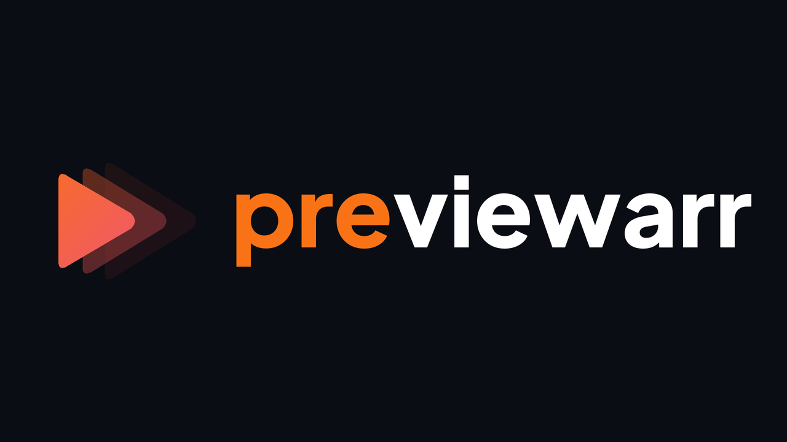

  

# Previewarr Mobile (preview)

> **This is a preview.** Previewarr Mobile is Viewarr for phones and tablets, built from the same code as Viewarr and Previewarr. It may change from one release to the next.

Previewarr Mobile has the same live TV, films and shows, music and recordings as Viewarr, with the pages laid out for fingers: big cards and posters, a bar of pages along the bottom, and a player that goes full screen when you turn the phone. It installs alongside the TV apps, and signs in to the same servers and accounts.

## Install

1. On your phone or tablet, open **aftv.news/9555036** in your browser (or enter the code **9555036** in the Downloader app), or this link; all of them always get the newest version:

   `https://github.com/petebutty/previewarr-mobile/releases/latest/download/previewarr-mobile.apk`

2. Open the downloaded file. Android asks to allow your browser to install apps: allow it, then install.
3. Open **Previewarr Mobile**.

Its downloads have their own page, [petebutty/previewarr-mobile](https://github.com/petebutty/previewarr-mobile/releases). Updates are offered in the app.

## Setup

The same accounts and sources as Viewarr: Dispatcharr (or an IPTV login), Plex, Jellyfin / Emby, Trakt, addons, TMDB and the rest. See the **[setup guide](SETUP.md)**. On a phone you type addresses and keys straight in, and links (Plex, Trakt, TMDB) open on the phone itself.

## Getting around

- **The bar along the bottom**: Live TV, Films, Shows, Streaming, Music and Recordings. Back from any of them goes to Live TV.
- **The bar along the top**: the page's name, and its buttons (search, the person button for Settings).
- **Back**: the phone's Back button, or a swipe in from the left edge of the screen (a round arrow follows your finger; let go once it turns orange).

## Live TV

- Your channel groups along the top, then a card per channel with what's on now.
- **Tap a channel** for its page: the picture at the top (tap it to watch), what's on now, and its programmes day by day. Turn the phone on its side, or tap the full-screen button, to watch full screen.
- **Swipe a channel left** for its guide, or **right** for the channel groups. Both slide across with your finger.
- On a channel's schedule, tap a programme still to come to **record** it, every episode or new episodes only. Tap an earlier one with catch-up to watch it from the start.
- Full screen: tap for the controls (previous and next channel, back and on 10 seconds, pause, picture size, the small window), and **More channels** (tap, or swipe up) to change channel without leaving full screen.

## Films and shows

- Rows of big posters, as on the TV, with a **search** box at the top.
- A title's page scrolls: the picture, a big **Play** (or Resume), the watchlist, what it's about, ratings, a show's seasons and episodes, cast, reviews and more like it.
- Play uses your Play order (Settings → Playback): a copy on your own server first, then your other servers, IPTV and addons. A bar at the bottom of the page shows what it's doing.
- The player: tap for the controls; double-tap the left or right side to skip 10 seconds; drag the bar to move through; Audio and Subtitles at the top. Back closes it.

## Streaming

A tile for each streaming service your addons have rows for (as on Previewarr's home screen). Tap one for its rows, films and shows together.

## Music

Your music home rows, search, album / playlist / artist pages with Play and Shuffle. While music plays, a small bar sits above the bottom bar; tap it for Now playing. Music keeps playing with the screen off or in another app, with the usual notification and lock-screen controls, and pauses when headphones come out.

## Recordings

Recorded (tap to play, sideways like films; long press to delete) and Coming up (tap to cancel), with your series recordings.

## Play on TV

The TV button (on a channel's page, the players, a title's page, and a recording's long press) lists the TVs with **Previewarr** open on the same Wi-Fi. Pick one and it plays there: a channel, a recording, or a film or episode. A TV only takes requests from a phone signed in to the same Dispatcharr account.

## Settings

The person button. Settings is laid out for a phone: Accounts & sources, Backup & sync, Appearance, Live TV, Playback, Notifications, Sports, Home Assistant, Troubleshooting, Advanced and About. Each setting is a switch or a list of choices from the bottom of the screen.

## Battery

Off screen, Previewarr Mobile doesn't refresh the guide or check for recordings, sports or sync: it catches up when you open it. The TV guide is fetched again at most twice a day (Settings → Advanced → TV guide refresh can make it less often).
